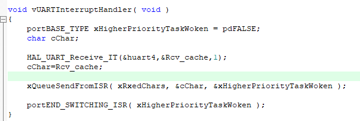
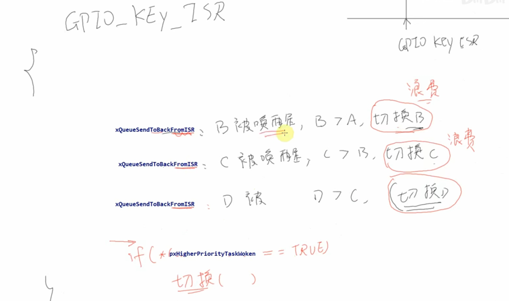

## 任务管理
## 队列

## 信号量
## 软件定时器

## 中断 

### 中断处理

    portEND_SWITCHING_ISR() 中断中上下文切换
    portYIELD_FROM_ISR() 中断中上下文切换

    taskDISABLE_INTERRUPTS() 关闭中断 只关闭可管理的优先级
    taskENABLE_INTERRUPTS() 开启中断

    taskENTER_CRITICAL(); 进入临界区 关闭PendSV和SysTick的中断，不会任务调度
    taskENTER_CRITICAL_FROM_ISR() 开启中断
    taskEXIT_CRITICAL() 退出临界区 打开PendSV和SysTick的中断
    taskEXIT_CRITICAL_FROM_ISR() 开启中断

    vTaskSuspendAll() 挂起任务调度
    xTaskResumeAll() 恢复任务调度

为什么不立即切换

