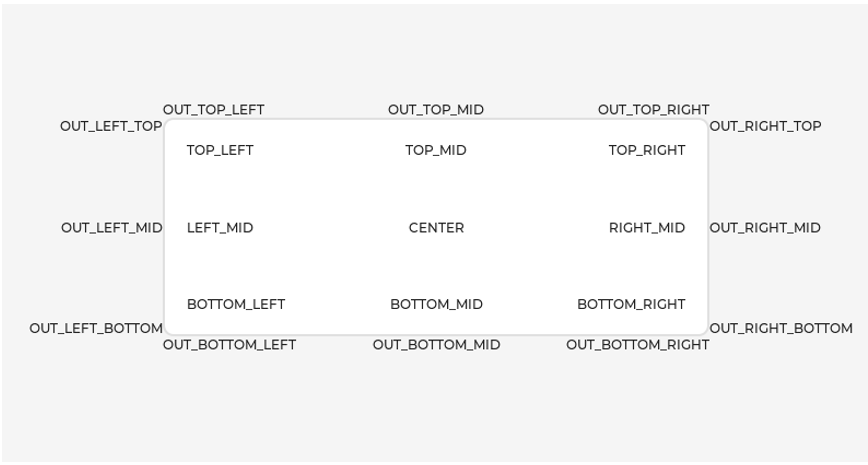

# core
## lv_obj
##  lv_obj_pos
### lv_obj_set_align

    void lv_obj_set_align(struct _lv_obj_t *obj, lv_align_t align)					Alignment（对齐）——将对象参照其父对象对齐
        LV_ALIGN_TOP_LEFT		定义在misc/lv_area.h中
        LV_ALIGN_TOP_MID 
        LV_ALIGN_TOP_RIGHT
        LV_ALIGN_LEFT_MID
        LV_ALIGN_CENTER
        LV_ALIGN_RIGHT_MID
        LV_ALIGN_BOTTOM_LEFT
        LV_ALIGN_BOTTOM_MID
        LV_ALIGN_BOTTOM_RIGHT
        
        LV_ALIGN_OUT_TOP_LEFT
        LV_ALIGN_OUT_TOP_MID
        LV_ALIGN_OUT_TOP_RIGHT
        LV_ALIGN_OUT_LEFT_TOP
        LV_ALIGN_OUT_LEFT_MID
        LV_ALIGN_OUT_LEFT_BOTTOM
        LV_ALIGN_OUT_RIGHT_TOP
        LV_ALIGN_OUT_RIGHT_MID
        LV_ALIGN_OUT_RIGHT_BOTTOM
        LV_ALIGN_OUT_BOTTOM_LEFT
        LV_ALIGN_OUT_BOTTOM_MID
        LV_ALIGN_OUT_BOTTOM_RIGHT



## lv_obj_style
## lv_obj_style_gen
## lv_theme
## lv_event
## lv_disp
# draw
# extra
# font
# hal
# misc
# widgets
# lv_conf.h

### lv_conf.h配置文件

```C
    /*====================COLOR SETTINGS*====================*/
    
    #define LV_COLOR_DEPTH 32				                                                                                        //定义颜色深度	1 (1 byte per pixel), 8 (RGB332), 16 (RGB565), 32 (ARGB8888)
    
    /*========================= MEMORY SETTINGS*=========================*/
    
    #define LV_MEM_CUSTOM 0									            //0使用lvgl内存分配   1使用c语言库内存分配
    #if LV_MEM_CUSTOM == 0
        #define LV_MEM_SIZE (1280 * 1024U)          /*[bytes]*/						//LVGL内存分配大小
    
        #define LV_MEM_ADR 0     /*0: unused*/
        
        #if LV_MEM_ADR == 0
            //#define LV_MEM_POOL_INCLUDE your_alloc_library 
            //#define LV_MEM_POOL_ALLOC   your_alloc         
        #endif
    
    #else       
        #define LV_MEM_CUSTOM_INCLUDE <stdlib.h>  
        #define LV_MEM_CUSTOM_ALLOC   malloc
        #define LV_MEM_CUSTOM_FREE    free
        #define LV_MEM_CUSTOM_REALLOC realloc
    #endif     
    
    /*====================
        HAL SETTINGS
        *====================*/
    
    #define LV_DISP_DEF_REFR_PERIOD 30      /*[ms]*/			//控制刷屏速度
    
    #define LV_INDEV_DEF_READ_PERIOD 30     /*[ms]*/			//输入速度
    
    #define LV_DPI_DEF 130     /*[px/inch]*/						//DPI     	DPI = ((√128*128) / 1.44) ≈ 89
    
    /*=======================
        * FEATURE CONFIGURATION
        *=======================*/
    
    /*-------------
        * Drawing
        *-----------*/
    
    /*-------------
        * GPU
        *-----------*/
    
    /*-------------
        * Logging
        *-----------*/
    
    #define LV_USE_LOG 1									//日志功能
    #if LV_USE_LOG
    
        /*How important log should be added:
        *LV_LOG_LEVEL_TRACE       A lot of logs to give detailed information
        *LV_LOG_LEVEL_INFO        Log important events
        *LV_LOG_LEVEL_WARN        Log if something unwanted happened but didn't cause a problem
        *LV_LOG_LEVEL_ERROR       Only critical issue, when the system may fail
        *LV_LOG_LEVEL_USER        Only logs added by the user
        *LV_LOG_LEVEL_NONE        Do not log anything*/
        #define LV_LOG_LEVEL LV_LOG_LEVEL_WARN
    
        /*1: Print the log with 'printf';
        *0: User need to register a callback with `lv_log_register_print_cb()`*/
        #define LV_LOG_PRINTF 1
    
        /*Enable/disable LV_LOG_TRACE in modules that produces a huge number of logs*/
        #define LV_LOG_TRACE_MEM        1
        #define LV_LOG_TRACE_TIMER      1
        #define LV_LOG_TRACE_INDEV      1
        #define LV_LOG_TRACE_DISP_REFR  1
        #define LV_LOG_TRACE_EVENT      1
        #define LV_LOG_TRACE_OBJ_CREATE 1
        #define LV_LOG_TRACE_LAYOUT     1
        #define LV_LOG_TRACE_ANIM       1
    
    #endif  /*LV_USE_LOG*/
    
    /*-------------
        * Asserts																//断言
        *-----------*/
    
    #define LV_USE_ASSERT_NULL          1   /*Check if the parameter is NULL. (Very fast, recommended)*/
    #define LV_USE_ASSERT_MALLOC        1   /*Checks is the memory is successfully allocated or no. (Very fast, recommended)*/
    #define LV_USE_ASSERT_STYLE         1   /*Check if the styles are properly initialized. (Very fast, recommended)*/
    #define LV_USE_ASSERT_MEM_INTEGRITY 1   /*Check the integrity of `lv_mem` after critical operations. (Slow)*/
    #define LV_USE_ASSERT_OBJ           1   /*Check the object's type and existence (e.g. not deleted). (Slow)*/
    
    /*Add a custom handler when assert happens e.g. to restart the MCU*/
    #define LV_ASSERT_HANDLER_INCLUDE <stdint.h>
    #define LV_ASSERT_HANDLER while(1);   /*Halt by default*/
    
    /*-------------
        * Others
        *-----------*/
    
    #define LV_USE_PERF_MONITOR 1						//CPU使用率和FPS
    
    #define LV_USE_MEM_MONITOR 1						//内存统计
    
    /*=====================
        *  COMPILER SETTINGS
        *====================*/
    
    
    /*==================
        *   FONT USAGE
        *===================*/
    
    /*字体使能*/
    #define LV_FONT_MONTSERRAT_8  1
    #define LV_FONT_MONTSERRAT_10 1
    #define LV_FONT_MONTSERRAT_12 1
    #define LV_FONT_MONTSERRAT_14 1
    #define LV_FONT_MONTSERRAT_16 1
    #define LV_FONT_MONTSERRAT_18 1
    #define LV_FONT_MONTSERRAT_20 1
    #define LV_FONT_MONTSERRAT_22 1
    #define LV_FONT_MONTSERRAT_24 1
    #define LV_FONT_MONTSERRAT_26 1
    #define LV_FONT_MONTSERRAT_28 1
    #define LV_FONT_MONTSERRAT_30 1
    #define LV_FONT_MONTSERRAT_32 1
    #define LV_FONT_MONTSERRAT_34 1
    #define LV_FONT_MONTSERRAT_36 1
    #define LV_FONT_MONTSERRAT_38 1
    #define LV_FONT_MONTSERRAT_40 1
    #define LV_FONT_MONTSERRAT_42 1
    #define LV_FONT_MONTSERRAT_44 1
    #define LV_FONT_MONTSERRAT_46 1
    #define LV_FONT_MONTSERRAT_48 1
    
    /*Demonstrate special features*/
    #define LV_FONT_MONTSERRAT_12_SUBPX      1
    #define LV_FONT_MONTSERRAT_28_COMPRESSED 1  /*bpp = 3*/
    #define LV_FONT_DEJAVU_16_PERSIAN_HEBREW 1  /*Hebrew, Arabic, Persian letters and all their forms*/
    #define LV_FONT_SIMSUN_16_CJK            1  /*1000 most common CJK radicals*/
    
    /*Pixel perfect monospace fonts*/
    #define LV_FONT_UNSCII_8  1
    #define LV_FONT_UNSCII_16 1
    
    /*Optionally declare custom fonts here.
        *You can use these fonts as default font too and they will be available globally.
        *E.g. #define LV_FONT_CUSTOM_DECLARE   LV_FONT_DECLARE(my_font_1) LV_FONT_DECLARE(my_font_2)*/
    #define LV_FONT_CUSTOM_DECLARE
    
    #define LV_FONT_DEFAULT &lv_font_montserrat_14										//定义默认字体
    
    /*Enable handling large font and/or fonts with a lot of characters.
        *The limit depends on the font size, font face and bpp.
        *Compiler error will be triggered if a font needs it.*/
    #define LV_FONT_FMT_TXT_LARGE 1
    
    /*Enables/disables support for compressed fonts.*/
    #define LV_USE_FONT_COMPRESSED 1
    
    /*Enable subpixel rendering*/
    #define LV_USE_FONT_SUBPX 1
    #if LV_USE_FONT_SUBPX
        /*Set the pixel order of the display. Physical order of RGB channels. Doesn't matter with "normal" fonts.*/
        #define LV_FONT_SUBPX_BGR 0  /*0: RGB; 1:BGR order*/
    #endif
    
    /*=================
        *  TEXT SETTINGS
        *=================*/
    
    /*==================
        *  WIDGET USAGE
        *================*/
    
    
    #define LV_USE_ARC        1
    #define LV_USE_ANIMIMG    1
    #define LV_USE_BAR        1
    #define LV_USE_BTN        1
    #define LV_USE_BTNMATRIX  1
    #define LV_USE_CANVAS     1
    #define LV_USE_CHECKBOX   1
    #define LV_USE_DROPDOWN   1   /*Requires: lv_label*/
    #define LV_USE_IMG        1   /*Requires: lv_label*/
    #define LV_USE_LABEL      1
    #if LV_USE_LABEL
        #define LV_LABEL_TEXT_SELECTION 1 /*Enable selecting text of the label*/
        #define LV_LABEL_LONG_TXT_HINT 1  /*Store some extra info in labels to speed up drawing of very long texts*/
    #endif
    #define LV_USE_LINE       1
    #define LV_USE_ROLLER     1   /*Requires: lv_label*/
    #if LV_USE_ROLLER
        #define LV_ROLLER_INF_PAGES 7 /*Number of extra "pages" when the roller is infinite*/
    #endif
    #define LV_USE_SLIDER     1   /*Requires: lv_bar*/
    #define LV_USE_SWITCH     1
    #define LV_USE_TEXTAREA   1   /*Requires: lv_label*/
    #if LV_USE_TEXTAREA != 0
        #define LV_TEXTAREA_DEF_PWD_SHOW_TIME 1500    /*ms*/
    #endif
    #define LV_USE_TABLE      1
    
    /*==================
        * EXTRA COMPONENTS
        *==================*/
    
    /*-----------
        * Widgets
        *----------*/
    #define LV_USE_CALENDAR   1
    #if LV_USE_CALENDAR
        #define LV_CALENDAR_WEEK_STARTS_MONDAY 0
        #if LV_CALENDAR_WEEK_STARTS_MONDAY
            #define LV_CALENDAR_DEFAULT_DAY_NAMES {"Mo", "Tu", "We", "Th", "Fr", "Sa", "Su"}
        #else
            #define LV_CALENDAR_DEFAULT_DAY_NAMES {"Su", "Mo", "Tu", "We", "Th", "Fr", "Sa"}
        #endif
    
        #define LV_CALENDAR_DEFAULT_MONTH_NAMES {"January", "February", "March",  "April", "May",  "June", "July", "August", "September", "October", "November", "December"}
        #define LV_USE_CALENDAR_HEADER_ARROW 1
        #define LV_USE_CALENDAR_HEADER_DROPDOWN 1
    #endif  /*LV_USE_CALENDAR*/
    
    #define LV_USE_CHART      1
    
    #define LV_USE_COLORWHEEL 1
    
    #define LV_USE_IMGBTN     1
    
    #define LV_USE_KEYBOARD   1
    
    #define LV_USE_LED        1
    
    #define LV_USE_LIST       1
    
    #define LV_USE_MENU       1
    
    #define LV_USE_METER      1
    
    #define LV_USE_MSGBOX     1
    
    #define LV_USE_SPINBOX    1
    
    #define LV_USE_SPINNER    1
    
    #define LV_USE_TABVIEW    1
    
    #define LV_USE_TILEVIEW   1
    
    #define LV_USE_WIN        1
    
    #define LV_USE_SPAN       1
    #if LV_USE_SPAN
        /*A line text can contain maximum num of span descriptor */
        #define LV_SPAN_SNIPPET_STACK_SIZE 64
    #endif
    
    /*-----------
        * Themes
        *----------*/
    
    /*A simple, impressive and very complete theme*/
    #define LV_USE_THEME_DEFAULT 1
    #if LV_USE_THEME_DEFAULT
    
        /*0: Light mode; 1: Dark mode*/
        #define LV_THEME_DEFAULT_DARK 0
    
        /*1: Enable grow on press*/
        #define LV_THEME_DEFAULT_GROW 1
    
        /*Default transition time in [ms]*/
        #define LV_THEME_DEFAULT_TRANSITION_TIME 80
    #endif /*LV_USE_THEME_DEFAULT*/
    
    /*A very simple theme that is a good starting point for a custom theme*/
    #define LV_USE_THEME_BASIC 1
    
    /*A theme designed for monochrome displays*/
    #define LV_USE_THEME_MONO 1
    
    /*-----------
        * Layouts
        *----------*/
    
    /*A layout similar to Flexbox in CSS.*/
    #define LV_USE_FLEX 1
    
    /*A layout similar to Grid in CSS.*/
    #define LV_USE_GRID 1
    
    /*---------------------
        * 3rd party libraries					组件使用
        *--------------------*/
    
    /*File system interfaces for common APIs */
    
    /*API for fopen, fread, etc*/
    #define LV_USE_FS_STDIO 1
    #if LV_USE_FS_STDIO
        #define LV_FS_STDIO_LETTER 'D'     /*Set an upper cased letter on which the drive will accessible (e.g. 'A')*/
        #define LV_FS_STDIO_PATH ""         /*Set the working directory. File/directory paths will be appended to it.*/
        #define LV_FS_STDIO_CACHE_SIZE  0   /*>0 to cache this number of bytes in lv_fs_read()*/
    #endif
    
    /*API for open, read, etc*/
    #define LV_USE_FS_POSIX 0
    #if LV_USE_FS_POSIX
        #define LV_FS_POSIX_LETTER '\0'     /*Set an upper cased letter on which the drive will accessible (e.g. 'A')*/
        #define LV_FS_POSIX_PATH ""         /*Set the working directory. File/directory paths will be appended to it.*/
        #define LV_FS_POSIX_CACHE_SIZE  0   /*>0 to cache this number of bytes in lv_fs_read()*/
    #endif
    
    /*API for CreateFile, ReadFile, etc*/
    #define LV_USE_FS_WIN32 0
    #if LV_USE_FS_WIN32
        #define LV_FS_WIN32_LETTER  'D'    /*Set an upper cased letter on which the drive will accessible (e.g. 'A')*/
        #define LV_FS_WIN32_PATH ""         /*Set the working directory. File/directory paths will be appended to it.*/
        #define LV_FS_WIN32_CACHE_SIZE 0    /*>0 to cache this number of bytes in lv_fs_read()*/
    #endif
    
    /*API for FATFS (needs to be added separately). Uses f_open, f_read, etc*/
    #define LV_USE_FS_FATFS  0
    #if LV_USE_FS_FATFS
        #define LV_FS_FATFS_LETTER '\0'     /*Set an upper cased letter on which the drive will accessible (e.g. 'A')*/
        #define LV_FS_FATFS_CACHE_SIZE 0    /*>0 to cache this number of bytes in lv_fs_read()*/
    #endif
    
    /*PNG decoder library*/
    #define LV_USE_PNG 1
    
    /*BMP decoder library*/
    #define LV_USE_BMP 1
    
    /* JPG + split JPG decoder library.
        * Split JPG is a custom format optimized for embedded systems. */
    #define LV_USE_SJPG 1
    
    /*GIF decoder library*/
    #define LV_USE_GIF 1
    
    /*QR code library*/
    #define LV_USE_QRCODE 1
    
    /*FreeType library*/
    #define LV_USE_FREETYPE 1
    #if LV_USE_FREETYPE
        /*Memory used by FreeType to cache characters [bytes] (-1: no caching)*/
        #define LV_FREETYPE_CACHE_SIZE (16 * 1024)
        #if LV_FREETYPE_CACHE_SIZE >= 0
            /* 1: bitmap cache use the sbit cache, 0:bitmap cache use the image cache. */
            /* sbit cache:it is much more memory efficient for small bitmaps(font size < 256) */
            /* if font size >= 256, must be configured as image cache */
            #define LV_FREETYPE_SBIT_CACHE 0
            /* Maximum number of opened FT_Face/FT_Size objects managed by this cache instance. */
            /* (0:use system defaults) */
            #define LV_FREETYPE_CACHE_FT_FACES 0
            #define LV_FREETYPE_CACHE_FT_SIZES 0
        #endif
    #endif
    
    /*Rlottie library*/
    #define LV_USE_RLOTTIE 0
    
    /*FFmpeg library for image decoding and playing videos
        *Supports all major image formats so do not enable other image decoder with it*/
    #define LV_USE_FFMPEG  0
    #if LV_USE_FFMPEG
        /*Dump input information to stderr*/
        #define LV_FFMPEG_AV_DUMP_FORMAT 0
    #endif
    
    /*-----------
        * Others
        *----------*/
    
    /*1: Enable API to take snapshot for object*/
    #define LV_USE_SNAPSHOT 1
    
    /*1: Enable Monkey test*/
    #define LV_USE_MONKEY   1
    
    /*1: Enable grid navigation*/
    #define LV_USE_GRIDNAV  1
    
    /*==================
    * EXAMPLES
    *==================*/
    
    /*Enable the examples to be built with the library*/
    #define LV_BUILD_EXAMPLES 1
    
    /*===================
        * DEMO USAGE
        ====================*/
    
    /*Show some widget. It might be required to increase `LV_MEM_SIZE` */
    #define LV_USE_DEMO_WIDGETS        0
    #if LV_USE_DEMO_WIDGETS
    #define LV_DEMO_WIDGETS_SLIDESHOW  0
    #endif
    
    /*Demonstrate the usage of encoder and keyboard*/
    #define LV_USE_DEMO_KEYPAD_AND_ENCODER     0
    
    /*Benchmark your system*/
    #define LV_USE_DEMO_BENCHMARK   0
    
    /*Stress test for LVGL*/
    #define LV_USE_DEMO_STRESS      0
    
    /*Music player demo*/
    #define LV_USE_DEMO_MUSIC       0
    #if LV_USE_DEMO_MUSIC
    # define LV_DEMO_MUSIC_SQUARE       0
    # define LV_DEMO_MUSIC_LANDSCAPE    0
    # define LV_DEMO_MUSIC_ROUND        0
    # define LV_DEMO_MUSIC_LARGE        0
    # define LV_DEMO_MUSIC_AUTO_PLAY    0
    #endif
```
## test
### null