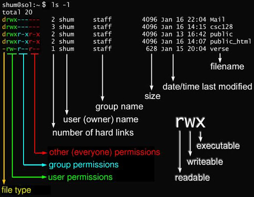

# linux常用命令

## 帮助手册

### man 查看命令帮助

[菜鸟教程](https://www.runoob.com/linux/linux-command-manual.html)

    #man下载    下载路径    ls /usr/share/man/

    sudo apt-get install manpages 
    sudo apt-get install manpages-de 
    sudo apt-get install manpages-de-dev 
    sudo apt-get install manpages-dev
    sudo apt-get install manpages-posix manpages-posix-dev

    #man手册标号
    1	可执行程序或 Shell 命令
    2	系统调用
    3	库调用
    4	特殊文件（通常位于 /dev 目录）
    5	文件格式和约定（比如 /etc/passwd）
    6	游戏
    7	杂项和约定
    8	系统管理命令（通常是 root 用户执行的命令）
    9	内核相关的文件 

    man man                 #进入帮助手册

    man -k -s 3 .           #查看某一标号下的所有命令
    apropos kill            #显示与指定关键字相关的所有 man 手册页的摘要信息

    man -f  cp              #查看命令所在页数
    man 1 kill              #查看某一标号下命令的详细信息

## 环境变量
### env 查看环境变量
### export 设置环境变量
### unset 删除环境变量
### echo 显示信息

        每个进程都维护着一个环境变量和自定义变量，进程可以通过这些变量访问计算机的资源   
        其中环境变量可以被子进程继承  自定义变量为进程私有

    pstree              #查看进程树

    bash                #在终端内再打开一个终端
    exit                #在终端内退出打开的新终端
    #######################环境变量#################################
    env                 #查看bash的环境变量
    env|grep beijing    #查找是否存在该环境变量 存在则显示，不存在则不显示

    beijing=3           #如果beijing是环境变量则将值更改为3，如果不是则为bash进程添加自定义变量，值为3

    echo $beijing       #$获取变量的值

    export name         #如果没有变量name，则声明临时环境变量name
                        #如果name是自定义变量，则声明成临时环境变量
    export name=3

    unset name          #删除变量name
    #######################自定义变量#################################
    echo $PS1           #PS1是bash的用户提示符自定义变量
    PS1="\W\$"          #临时修改PS1为  \W当前工作路径的最后一个目录 \$

    临时修改环境变量
        export PATH=/home/orangepi/workspece/:$PAHT #临时环境变量到PAHT最前边
                PATH=$PATH:.                        #临时追加当前目录到PAHT最后边
    
    追加环境变量到bash 
        vim ~/.bashrc       
        export PATH=/home/orangepi/workspece/:$PAHT
        source .bashrc      

    PAHT 中有/bin/      把需要查找的东西放在/bin/

## 程序编译

### nm 查看文件符号表

    nm   a.out          #查看文件节区

### ldd 查看文件依赖库

    ldd  a.out          #查看可执行文件对动态库的依赖

## 内存管理
### free 查看内存使用情况

    free

## 进程及进程管理

### ps 查看进程

    ps                  #查看当前进程
    ps -aux             #查看系统的进程情况

### pstree 查看进程树

    pstree              #查看用户级进程树

### top 查看进程实时状态

    top                 #查看系统的进程情况

## 文件及目录管理

### file 查看文件类型

    file  asd          #查看文件类型

### ls 查看目录内容

    ls
    ls -a   #全部文件，包括隐藏文件
    ls -d   #仅列出目录，而不列出目录内的文件
    ls -h   #高可读性形式

    ls -i   #列出文件的inode号 
    ls -l   #详细列表形式

    ls -lah /home

    - 普通文件
    d 文件夹文件
    c 字符设备
    b 块设备
    p 管道
    s 套接字
    l 软链接文件

### stat 查看文件元数据

    stat Linux.md   #详细查看文件的元数据

### umask 设置文件权限掩码

    umask           #查看umask   umask置1则表示创建文件时该位默认权限为0
    umask  0444     #设置umask为0444 

### chmod 修改文件权限

    chmod 0770 test.c         

    chmod u=rwx,g=rwx,o= test.c

|数字|通常省略|所有者|同组用户|其他用户|
|---|---|---|---|---|
|4 r (读)|	-|	r|	r|	无权限|
|2 w (写)|	-|	w|	w|	无权限|
|1 x (执行)|	-|	x|	x|	无权限|
|0 无权限|	-|	无权限|	无权限|	无权限|

|命令|对象|操作符|权限|适用范围|
|---|---|---|---|---|
|chmod|	u (所有者)  g (所属组) o (其他用户) a (所有用户)|+ (添加) - (移除) = (设定)|	r (读取) w (写入)  x (执行)	|	文件或目录|

### chown 修改文件所有者
### chgrp 修改文件所属组
### ln 创建链接

    ln hello.c  heelo.c         #创建硬链接
        硬链接：
        1.硬链接，以文件副本的形式存在。但不占用实际空间。
        2.硬链接只有在同一个文件系统中才能创建
        3.不允许给目录创建硬链接                   
    ln -s hello.c  hello2.c     #创建软链接
        软链接：
        1.软链接，以路径的形式存在。类似于Windows操作系统中的快捷方式
        2.软链接可以 跨文件系统 ，硬链接不可以
        3.软链接可以对目录进行链接
        4.软链接可以对一个不存在的文件名进行链接

### pwd 查看当前目录

    pwd                 #显示目前所在的目录
    pwd -P              #显示出确实的路径，而非使用连接(link)路径

### cd 切换目录

    cd /home/orangepi/workspece/CProject    #打开指定路径
    cd ..                                    #返回上一级目录
    cd ~                                     #返回家目录

### mkdir 创建目录

    mkdir test
    mkdir test -m 777           #-m 指定权限
    mkdir -p test/test1/test2   #-p 递归创建

### rmdir 删除目录

    rmdir test/          #删除空目录

### touch 创建文件

    touch test.txt          #创建文件

### cp 复制文件

    cp test.txt test1.txt          #复制文件
    cp -r test/ test1/          #递归复制目录

### rm 删除文件

    rm -i test/             #互动模式，删除前询问
    rm -r test/          #递归删除目录

### mv 移动文件

    mv test.txt test1.txt          #重命名文件
    mv oldfile.txt /path/to/newfile.txt          #移动并重命名文件
    mv test1/  test2        
        如果 test1/ 存在，且 test2/ 不存在，则 test1/ 被重命名 为 test2/。
        如果 test2/ 已存在，则 test1/ 会被 移动到 test2/ 目录下，变成 test2/test1/
    mv test/ test1/          
        前提：test2/ 必须是一个已存在的目录！
        这个命令的作用是 将 test1/ 目录移动到 test2/ 目录中，变成 test2/test1/

### cat 查看文件内容

    cat test2.c

    cat -b test2.c      #列出行号  没有空白行
    cat -n test2.c      #列出行号  带空白行

### tar 打包文件

    -c              #压缩
    -x              #解压

    -z              #gzip格式   压缩归档文件  后缀 tar.gz
    -j              #bzip2格式  压缩归档文件  后缀 tar.bz2

    -v              #显示正在处理的文件

    -f asx.tar.gz   #指定操作的包名

    -C              #指定解压路径

    tar -zxvf example.tar.gz -C test3/   #解压gzip压缩包
    tar -zcvf example.tar.gz test        #压缩gzip压缩包

    tar -jxvf example.tar.bz2 -C test3/   #解压bzip2压缩包
    tar -jcvf example.tar.bz2 test        #压缩bzip2压缩包

## 网络

### ifconfig 查看网络接口信息

    ifconfig    #查看本地网络信息
    sudo ifconfig ens33 192.168.3.45 #设置IP地址
    sudo ifconfig ens33 down        #关闭网卡
    sudo ifconfig ens33 up         #打开网卡

### ping 测试网络连接

    ping 192.168.3.45      #测试网络连接

### route 查看路由表

    route           #查看路由表

### arp 查看和修改ARP缓存

    arp -a           #查看ARP缓存

## 系统管理

### uname 查看系统信息

    uname -a           #查看系统信息

### su 切换用户

    su root           #切换到root用户

### exit 退出当前用户

    exit           #退出当前用户

### clear 清屏

    clear           #清屏

### bash 新建终端

    bash           #新建终端

### reset 重置终端

    reset           #重置终端

### poweroff 关机

    poweroff           #关机

### reboot 重启系统

    reboot           #重启系统

### shutdown 关机或重启

    shutdown -h now           #关机
    shutdown -r now           #重启

## 软件管理

### wget 下载文件

    # 软件包的类型
    #     二进制软件包 (deb) ——code_1.82.2-1694671812_amd64.deb  包名_版本-修订版本_体系架构
    #     源码包(deb-src)——由tar工具归档为.tar.gz文件，然后再打包成.dsc文件

    wget --version                                          #查看wget的版本信息
    wget http://example.com/file.zip                        #下载文件
    wget -O newfilename.zip http://example.com/file.zip     #-O下载文件并重命名
    wget -b http://example.com/file.zip                     #-b后台下载（不在终端中显示下载进度）
    wget -c http://example.com/largefile.zip                #-c断点续传下载
    wget -P /path/to/your/directory http://example.com/largefile.zip    #-P指定下载路径 

### dpkg 安装软件

    dpkg -i curl_7.68.0-1ubuntu2.6_amd64.deb        #安装
    dpkg -L curl                                    #列出安装的软件包清单
    dpkg -s curl                                    #显出软件包的安装状态
    dpkg -r curl                                    #移除一个已经安装的软件包
    dpkg -P curl                                    #移除已安装软件包及配置文件

### apt 安装软件

    apt-get update               #1.更新下载源       
    apt-get install vim         #2.安装vim 软件
    apt-get upgrade vim         #3.更新软件
    apt-get remove vim          #4.卸载软件

    apt list --installed        #列出所有已经安装的软件
    apt-cache pkgnames          #列出已安装的软件包名称
    apt list --upgradable       #列出可更新的软件包
    sudo apt-get upgrade        #更新所有可更新的软件
    sudo apt-get install -f     #检查并修复所有依赖

## 磁盘管理
### df 查看磁盘空间

    df              #列出文件系统的整体磁盘使用量
    df -T           #显示详细信息
    df -h           #以方便查看的形式输出

### lsblk 查看块设备

    lsblk -o NAME,SIZE,TYPE,MOUNTPOINT