# tools

## windows

    D:\Program\mingw64
    D:\Program\cmake-3.27.1-windows-x86_64
    D:\Program\env-windows-1.5.2
    D:\Program\gcc-arm-none-eabi-10.3-2021.10
    D:\Program\OpenOCD-20231002-0.12.0
    D:\Program\python


    path
        D:\Program\mingw64\bin
        D:\Program\cmake-3.27.1-windows-x86_64\bin
        D:\Program\gcc-arm-none-eabi-10.3-2021.10\bin
        D:\Program\OpenOCD-20231002-0.12.0\bin

## wsl2

### Hyper-V

    bcdedit /set hypervisorlaunchtype auto          管理员身份
    bcdedit /set hypervisorlaunchtype off           

    bcdedit /enum | findstr hypervisorlaunchtype    管理员身份


### wsl

    wsl --install --no-distribution                 管理员身份

    重启

    wsl.exe --list --online             #查看在线列表

    wsl --install -d Ubuntu-22.04 --location D:\app\WSL\Ubuntu_2204

    wsl -l -v                           #查看

    wsl --shutdown                      #wsl关机

        sudo apt update
        sudo apt upgrade

        配置wsl性能参数
            free -h         10/16       swap4
            nproc           27/32
            网络            映射模式

        文件
            \\wsl$      win文件访问wsl
        
            在Ubuntu终端里，Windows的所有硬盘分区都自动挂载在 /mnt/ 目录下。
            路径对照：Windows的C盘对应 /mnt/c/，D盘对应 /mnt/d/，以此类推。
        显卡    
            nvidia-smi

### NVIDIA Container Toolkit

https://docs.nvidia.com/datacenter/cloud-native/container-toolkit/latest/install-guide.html

        sudo apt-get update && sudo apt-get install -y --no-install-recommends \
    ca-certificates \
    curl \
    gnupg2


        curl -fsSL https://nvidia.github.io/libnvidia-container/gpgkey | sudo gpg --dearmor -o /usr/share/keyrings/nvidia-container-toolkit-keyring.gpg \
    && curl -s -L https://nvidia.github.io/libnvidia-container/stable/deb/nvidia-container-toolkit.list | \
        sed 's#deb https://#deb [signed-by=/usr/share/keyrings/nvidia-container-toolkit-keyring.gpg] https://#g' | \
        sudo tee /etc/apt/sources.list.d/nvidia-container-toolkit.list


    sudo apt-get update


    sudo apt-get install -y nvidia-container-toolkit    

    nvidia-ctk --version

    docker配置nvidia
        sudo nvidia-ctk runtime configure --runtime=docker                                          修改 Docker 的配置文件，让 Docker 知道以后如何调用 NVIDIA Container Runtime                           

        sudo systemctl restart docker                                                               重启容器服务

        sudo docker run --rm --gpus all nvcr.io/nvidia/k8s/cuda-sample:nbody nbody -gpu -benchmark   性能测试

### usbipd

    winget install --exact dorssel.usbipd-win 		管理员打开powershell

    usbipd list

    usbipd bind --busid 1-2						    设置成share

    usbipd attach --wsl --busid 1-2					attach 单次生效

    lsusb
    ls /dev/tty*


## ubuntu

[VMware](https://github.com/201853910/VMwareWorkstation)

[Ubuntu下载](https://cn.ubuntu.com/download)  
[Ubuntu22LTS](https://www.releases.ubuntu.com/22.04/)


    unrar x yourfile.rar                                        #解压                           
    rar a -r -v esp_esp32s3_szp.rar esp_esp32s3_szp/            #压缩
    
    cp -r esp_hello_world my_project                            #复制
    
    tree tree -L 1                                              #查看一层文件内容   
    ls -a
    
    ls -lh note_md/asset_doc/freertos.excalidraw                #查看文件内存占用
    du -sh workspece/                                           #查看文件夹内存占用
    du -h --max-depth=1                                         #查看一层文件磁盘占用

    ------------------------------------------------------------------------------------

    sudo vim ~/.bashrc
    
    alias armgccinit='python3 /home/sean/studio/c_cpp_workspace/tool/armgcc_init.py'
    alias gccinit='python3 /home/sean/studio/c_cpp_workspace/tool/gcc_init.py'
    alias idfinit='python3 /home/sean/studio/c_cpp_workspace/tool/idf_init.py'
    alias rttinit='python3 /home/sean/studio/c_cpp_workspace/tool/rtt_init.py'
    alias cubeprg='/home/sean/program/stm32cubeprg/bin/STM32CubeProgrammer'
    alias cubemx='/home/sean/program/stm32cubemx/STM32CubeMX'

    source ~/.bashrc

    ip addr		

    uname -m

        x86_64	64位的 Intel 或 AMD 处理器（最常见）	amd64.deb
        aarch64 或 arm64	64位的 ARM 处理器（如树莓派、某些云服务器、苹果 M 系列芯片的虚拟机）	arm64.deb


    windows管理员权限启动终端
        bcdedit /set hypervisorlaunchtype off   关闭默认虚拟机虚拟化
        bcdedit /set hypervisorlaunchtype auto


    ubuntu内安装vmtools
        sudo apt install open-vm-tools open-vm-tools-desktop -y
        sudo reboot


    设置中文 Region & Language  然后  Manage Installed Languages

    去掉Ubuntu桌面上的主目录图标。
        在Ubuntu桌面上，右键单击空白区域-》“显示个人文件夹”的切换选项，将其关闭
    虚拟机移除 CD/软盘

    root set
        sudo passwd root
        su root						123465
        exit


    vim
        sudo apt-get install vim                                    #安装vim
        vim -v  /vim --version                                      #查看安装是否成功 

        #设置vim缩进
        sudo vi /etc/vim/vimrc       
            #最后一行输入set tabstop=4

        #使用

    git
        sudo apt install git


    Clash
        #1.安装
        sudo dpkg -i Clash.Verge_2.4.3+autobuild.1016.fd5bdde_amd64.deb     #安装
        sudo dpkg -P clash-verge/sudo dpkg --purge clash-verge              #卸载

        sudo dpkg --purge clash-verge


        sudo apt --fix-broken install                                       #修复安装过程中的依赖

        #2.测试终端
        sudo apt install curl
        curl -i google.com 
        export http_proxy=http://127.0.0.1:7897
        export https_proxy=http://127.0.0.1:7897

        #3.设置终端代理
        sudo vi ~/.bashrc                                           #设置每个终端的代理
        #添加下两行
        export http_proxy=http://127.0.0.1:7897;
        export https_proxy=http://127.0.0.1:7897;
        source ~/.bashrc                                            #设置立即生效


        https://github.com/nelvko/clash-for-linux-install

        git clone --branch master --depth 1 https://gh-proxy.org/https://github.com/nelvko/clash-for-linux-install.git

        source ./scripts/cmd/clashctl.sh && clashon

        clashon         开启代理
        clashoff        已关闭代理环境

        clashtun        全局代理 状态
        clashtun on     Tun 模式已开启
        clashtun off

        clashsecret 123456
        clashsecret
        clashui

        clashsub ls

    更新

        sudo add-apt-repository universe        #开启 universe 仓库
        sudo apt-get update
        sudo apt-get upgrade            #升级系统中已安装的软件包 到最新版

    unrar/rar
        sudo apt install unrar
        unrar -verson
        unrar x yourfile.rar                                        #解压

        sudo apt install rar
        rar -version
        rar a -r esp_esp32s3_szp.rar esp_esp32s3_szp/               #压缩

        unzip stm32cubemx-lin-v6-16-1.zip -d stm32cubemx
        

    tree
        sudo apt install tree
        tree --version

        tree tree -L 1                                              #查看一层文件内容


    ssh
        sudo apt-get install openssh-server    #1.安装ssh服务器

        sudo /etc/init.d/ssh start             #2.开启ssh服务

        ps -e | grep ssh                       #3.查看ssh服务器是否在运行

        sudo vi /etc/ssh/sshd_config            #4.设置允许用户登录(默认不允许)   PermitRootLogin yes
            
            #LoginGraceTime 2m
            PermitRootLogin yes
            #StrictModes yes
            #MaxAuthTries 6
            #MaxSessions 10
            
        sudo /etc/init.d/ssh restart            #5.重启ssh服务

        
        sudo systemctl enable ssh               #设置开机自启动


    samba

        sudo apt update                     

        sudo apt install samba

        samba --version
        Version 4.15.13-Ubuntu

        ls /etc/samba/                      查看配置文件
        gdbcommands  smb.conf  tls

        sudo vim /etc/samba/smb.conf
                #末尾添加
                [sean] 
                    path = /home/sean/workspace
                    browsable = no 
                    writable = yes 
                    read only = no 
                    guest ok = no


        sudo smbpasswd -a sean

        sudo service smbd restart           重启服务

        sudo ufw allow samba                设置防火墙

        systemctl is-enabled smbd           开机自启动

    docker

        https://docs.docker.com/engine/install/ubuntu/  
        https://hub.docker.com/

        docker --version

        Dev Containers


        mkdir docker-cross-demo
        cd docker-cross-demo
        mkdir gcc-env mingw-env src


        vim src/main.c                                  

        #include <stdio.h>

        int main() {
            printf("Hello Docker Cross Build!\n");
            return 0;
        }

        ----------------------------------1容器组件描述-----------------------------------------
        vim gcc-env/Dockerfile                              gcc-env容器测试


        FROM ubuntu:22.04

        RUN apt update && apt install -y \
            build-essential \
            cmake \
            gdb

        WORKDIR /workspace

        ----------------------------------2构建镜像-----------------------------------------
        sudo docker build \
        --build-arg http_proxy=http://192.168.1.104:7897 \
        --build-arg https_proxy=http://192.168.1.104:7897 \
        -t gcc-env ./gcc-env

        ----------------------------------3使用镜像创建容器-----------------------------------------
        sudo docker run -it --rm \
        -v $PWD:/workspace \
        gcc-env\
        bash
        ----------------------------------4-----------------------------------------
        gcc src/main.c -o app
        ./app

        ----------------------------------5-----------------------------------------
        exit

        ----------------------------------1-----------------------------------------
        vim mingw-env/Dockerfile                           mingw-env容器测试

        FROM ubuntu:22.04

        ENV DEBIAN_FRONTEND=noninteractive

        RUN apt update && apt install -y \
            mingw-w64 \
            gdb\
            make \
            cmake 

        WORKDIR /workspace

        ----------------------------------2-----------------------------------------
        sudo docker build \
        --build-arg http_proxy=http://192.168.1.104:7897 \
        --build-arg https_proxy=http://192.168.1.104:7897 \
        -t mingw-env ./mingw-env
        ----------------------------------3-----------------------------------------
        sudo docker run -it --rm \
        -v $PWD:/workspace \
        mingw-env\
        bash
        ----------------------------------4-----------------------------------------
        x86_64-w64-mingw32-gcc src/main.c -o app.exe


        ----------------------------------1-----------------------------------------
        export HTTP_PROXY="http://192.168.1.105:7897"
        export HTTPS_PROXY="http://192.168.1.105:7897"


        https://hub.docker.com/r/espressif/idf/tags

        sudo -E  docker pull espressif/idf:v5.4.4


        unset HTTP_PROXY
        unset HTTPS_PROXY

        ----------------------------------3-----------------------------------------
        sudo docker run -it --rm \
        -v $PWD:/workspace \
        espressif/idf:v5.4.4\
        bash

        sudo docker run -it --rm \
        --device=/dev/ttyUSB0 \
        -v $PWD:/workspace \
        espressif/idf:v5.4.4 \
        bash

        cd /workspace/my_project
        idf.py -p /dev/ttyUSB0 flash monitor
        ----------------------------------5-----------------------------------------
        exit

        sudo usermod -aG docker sean    用户添加进docker组

        getent group docker             查看docker组


        sudo docker images              查看镜像

        sudo docker ps                  查看镜像实例

        Dockerfile 
        镜像
        容器
        docker-compose.yml
        docker compose up

        docker volume ls

        docker volume inspect voicebox_voicebox-data
        docker volume inspect voicebox_huggingface-cache

        docker volume rm voicebox_voicebox-data voicebox_huggingface-cache

        

    软件源
    
        https://developer.aliyun.com/mirror/ubuntu/

        https://mirrors.tuna.tsinghua.edu.cn/help/ubuntu/

        sudo mv /etc/apt/sources.list /etc/apt/sources.list.bak

        sudo cp /etc/apt/sources.list.bak /etc/apt/sources.list

        sudo vim /etc/apt/sources.list
        编辑内容
            deb https://mirrors.tuna.tsinghua.edu.cn/ubuntu/ jammy main restricted universe multiverse
            # deb-src https://mirrors.tuna.tsinghua.edu.cn/ubuntu/ jammy main restricted universe multiverse
            deb https://mirrors.tuna.tsinghua.edu.cn/ubuntu/ jammy-updates main restricted universe multiverse
            # deb-src https://mirrors.tuna.tsinghua.edu.cn/ubuntu/ jammy-updates main restricted universe multiverse
            deb https://mirrors.tuna.tsinghua.edu.cn/ubuntu/ jammy-backports main restricted universe multiverse
            # deb-src https://mirrors.tuna.tsinghua.edu.cn/ubuntu/ jammy-backports main restricted universe multiverse
            deb http://security.ubuntu.com/ubuntu/ jammy-security main restricted universe multiverse
            # deb-src http://security.ubuntu.com/ubuntu/ jammy-security main restricted universe multiverse
            # deb https://mirrors.tuna.tsinghua.edu.cn/ubuntu/ jammy-proposed main restricted universe multiverse
            # deb-src https://mirrors.tuna.tsinghua.edu.cn/ubuntu/ jammy-proposed main restricted universe multiverse

        sudo apt update                                             #更新 apt 软件包列表

    pip清华源
        mkdir  ~/.pip
        vi ~/.pip/pip.conf
        编辑内容
            [global]
            index-url = https://pypi.tuna.tsinghua.edu.cn/simple
            
            [install]
            trusted-host=pypi.tuna.tsinghua.edu.cn

        脚本
            chmod +x env_1.sh					tool  download					
            sudo ./env_1.sh

    github DNS
        sudo vi /etc/hosts
            20.205.243.166                github.com

    frp

        #################################下载#################################
        https://github.com/fatedier/frp/releases 

        #################################服务器配置#################################

        ----------------------------1.新建文件夹解压frp压缩包-----------------------
        mkdir /home/nat
        tar -xvf frp_0.47.0_linux_amd64.tar.gz -C /home/nat/
        cd /home/nat
        mv frp_0.47.0_linux_amd64 frp
        ----------------------------2.修改配置文件--------------------------------
        cd frp
        vi frps.ini
                [Unit]
                [common]
                bind_port = 7000
                dashboard_port = 7500
                dashboard_user = admin
                dashboard_pwd = admin
                enable_prometheus = true
                authentication_method = token
                token = 584271            
        ----------------------------3.测试服务器启动--------------------------------
        ./frps -c ./frps.ini    #启动服务  Ctrl+C 中止
        ----------------------------4.创建frp服务器进程跟随服务器自启动-----------------
        vi /etc/systemd/system/frps.service #创建进程
                [Unit]
                Description=frpc daemon
                After=syslog.target network.target
                Wants=network.target
                
                [Service]
                Type=simple
                ExecStart=/home/nat/frp/frps -c /home/nat/frp/frps.ini
                
                [Install]
                WantedBy=multi-user.target
        systemctl enable frps   #设置进程开机启动
        systemctl start frps    #启动进程
        ----------------------------5.开启相关端口--------------------------------
        7000
        7500  
        ----------------------------6.重启服务器--------------------------------

        ---------------7.http://123.123.123.123:7500 查看控制台信息-----------------

        #################################客户端配置#################################
        ----------------------------1.新建文件夹解压frp压缩包-----------------------
        mkdir /home/sean/nat
        tar -xvf frp_0.47.0_linux_amd64.tar.gz -C /home/sean/nat/
        cd /home/sean/nat
        mv frp_0.47.0_linux_amd64 frp
        ----------------------------2.修改配置文件--------------------------------
        cd frp
        vi frpc.ini
                [common]
                server_addr = 120.55.79.166
                server_port = 7000
                token = 123456

                [1ssh]
                type = tcp
                local_ip = 127.0.0.1
                local_port = 22
                remote_port = 6022
        ----------------------------3.在服务器中打开映射的端口号  6022-----------
        ----------------------------4.测试启动--------------------------------
        ./frpc -c ./frpc.ini    #启动服务  Ctrl+C 中止
        ----------------------------5.frp服务器进程自启动--------------------------------
        sudo vi /etc/systemd/system/frpc.service
                [Unit]
                Description=frpc daemon
                After=syslog.target network.target
                Wants=network.target

                [Service]
                Type=simple
                Restart=on-failure
                RestartSec=5s
                ExecStart=/home/sean/nat/frp/frpc -c /home/sean/nat/frp/frpc.ini

                [Install]
                WantedBy=multi-user.target
        sudo systemctl enable frpc  #设置进程开机启动
        sudo systemctl start frpc   #启动进程


    


## vscode


[VScode官网](https://code.visualstudio.com/)


    Ctrl+/              单行注释或取消注释  
    shift +alt +a       多行注释

    Ctrl+F              查找与替换 
    
    Ctrl+K+0(零)        折叠代码块
    Ctrl+K+J            展开代码块
    
    Ctrl + [            左缩进
    Ctrl + ]            右缩进
    
    Ctrl + Alt +上下键   选中多行
    Alt +鼠标左键        点击选中多行
    
    Ctrl +J             隐藏/显示终端
    
    ctrl shift P        task
    ctrl shift B        vscode task
    
    ctrl选中两文件       右击选中比较


    安装插件
        
        Chinese
        Excalidraw

        Remote - SSH
        Remote - SSH: Editing Configuration Files
        Remote - Tunnels
        Remote Explorer

        WSL
        
        Compare Folders

        One Dark Pro

        Arm Assembly
        C/C++
        CMake

        Cortex-Debug
        debug-tracker-vscode
        MemoryView
        Peripheral Viewer
        RTOS Views

        Python
        Python Debugger
        Pylance
        Python Environments

    vscode_linux_install

        #添加VSCode存储库：将Microsoft的存储库添加到您的系统中。这将帮助您保持VSCode最新并通过包管理器安装
        sudo sh -c 'echo "deb [arch=amd64] http://packages.microsoft.com/repos/vscode stable main" > /etc/apt/sources.list.d/vscode.list'
        #导入Microsoft GPG密钥以确保软件包的完整性
        wget -qO- https://packages.microsoft.com/keys/microsoft.asc | gpg --dearmor > packages.microsoft.gpg
        sudo mv packages.microsoft.gpg /etc/apt/trusted.gpg.d/
        #安装VSCode
        sudo apt-get update
        sudo apt-get install code
        
        sudo apt remove --purge code    #卸载Visual Studio Code
        sudo apt autoremove             #删除已安装的依赖库
        sudo apt clean                  #清理不再需要的软件包

        ---------------------------------------

        sudo dpkg -i code_1.117.0-1776814346_amd64.deb 


    powershell设置中文
        $OutputEncoding = [Console]::OutputEncoding = [Text.UTF8Encoding]::new($false) 

    cmd 终端设置中文
        chcp

        chcp 936
        chcp 65001


    vscode Remote-SSH
        1 
        #添加新的主机——ssh sean@192.168.31.181:22  输入key——跳过   输入密码  
        
        2.ubuntu切换模式
        
        systemctl get-default       #查看当前是多用户模式还是图形模式 graphical.target图形模式  multi-user.target 多用户模式
        sudo systemctl set-default multi-user.target #设置启动时默认多用户模式 
        sudo vim /etc/systemd/system/getty.target.wants/getty@tty1.service #选择用户自动登录
        #注释1行并添加一行
        #ExecStart=-/sbin/agetty -o '-p -- \\u' --noclear %I $TERM
        ExecStart=-/sbin/agetty -a sean --noclear %I $TERM
        
        3.ssh key
        
        #windows操作
            ssh-keygen -t rsa -C "xxx@xxx.com" -f vscode  #windows生成sshkey
            scp C:\Users\54411\.ssh\id_rsa.pub sean@192.168.31.181:~ #复制ssh到linux home目录下
        
        #linux操作

            mkdir ~/.ssh
            touch ~/.ssh/authorized_keys

            chmod 700 ~/.ssh
            chmod 600 ~/.ssh/authorized_keys

            cat id_rsa.pub >> ~/.ssh/authorized_keys    #追加win sshkey到linux sshkey
        
        #windows下C:\Users\54411\.ssh\config 配置文件中添加私钥配置 IdentityFile "C:\Users\54411\.ssh\vscode"


## git


[git官网](https://git-scm.com/docs/git)  
[git手册](https://git-scm.com/docs)   

### git_cmd


    
    工作区  ----- 暂存区  ---- 版本库 ------ 远程仓库
            (add)     (commit)      (push)

    #################################git手册#################################

    git --help
    git help git
    git <verb> --help       #查看命令的全面手册
    git add -h              #查看命令的参数选项

    #################################本地仓库#################################

    #首次使用配置个人用户信息   
    git config --global user.name "qtest"               #配置用户名
    git config --global user.email 544115819@qq.com     #配置邮箱
    git config --list                                   #查看配置信息

    #git config --global core.autocrlf input             

    git init                                            #创建新的本地仓库

    git add .                                           #添加所有工作区文件到暂存区
    git commit -m [add1]                                #提交暂存区到版本库并添加备注

    git tag                                             #查看标签 
    git tag v1.00 85fc7e7                               #设置标签
    git tag -d v1.00                                    #删除标签

                                                        #移动HEAD
    git switch --detach 08db890             git checkout 60e413c        
    git switch --detach v1.00               git checkout v1.00
    git switch master                       git checkout master

    git restore --source 08db890 t1.txt     git checkout 08db890 -- t1.txt 
    git restore --source=HEAD t1.txt(git restore t1.txt)
                                            git checkout HEAD^0 .
                                            git checkout v1.00 .
    
                                                        #移动HEAD 和 master
    git reset --hard 5f26c92                            #撤销提交记录 ，改动完全消失回退
    git reset --soft 5f26c92                            #撤销提交记录 , 改动会保留在暂存区
    git reset 5f26c92(git reset --mixed 5f26c92)        #撤销提交记录 ，改动留在工作区但不放进暂存区

    git reset --hard 5f26c92 
    git clean -fdx

    git status                                          #查看状态
    git status -s                                       #简洁状态查看
    #第一个M表示此文件的暂存区和版本库不同  第二个M表示此文件的工作区和暂存区不同

    git log                                             #查看提交历史
    git log --oneline                                   #简洁查看

    git reflog                                          # 查看log

    git diff                                            #比较工作区与暂存区文件不同
    git diff --cached                                   #比较暂存区与版本库的不同

    git config --global http.proxy http://127.0.0.1:7897
    git config --global https.proxy http://127.0.0.1:7897
    git config --global --unset http.proxy 
    git config --global --unset https.proxy

    #################################远程仓库#################################

    #配置仓库ssh
    ssh-keygen -t rsa -C "544115819@qq.com"                 #rsa加密生成sshkey  在gitbesh中操作
    ssh-keygen -t ed25519 -C "544115819@qq.com"             #ed25519加密生成sshkey

    $ clip < ~/.ssh/id_rsa.pub                              #cmd  复制sshkey  
    Get-Content ~\.ssh\id_ed25519.pub | Set-Clipboard       #powershell 复制sshkey

    cat ~\.ssh\id_ed25519.pub                               #手动查看

    ssh -T git@github.com                                   #测试github ssh添加完成  第一次链接要输入yes

    git remote rm origin                                        #删除链接
    git remote add origin git@github.com:xxx/xxx.git            #链接本地仓库与远程仓库
    git remote -v

    git push origin master                                   #git push 提交版本库到远程仓库

    git clone gitagithub.com:xxx/xxx.git                 #git clone 下载远程仓库到本地 

    git clone -b v1.5.2 https://github.com/RT-Thread/env-windows.git
    git clone -b mooncake_v8 --no-checkout git@github.com:Forairaaaaa/lv_port_pc_eclipse.git  不自动检出文件

    #################################历史重写器#################################

    git rebase -i --root                            启动“历史重写器”


    edit bed1545 add_v4.1.0                         设置历史重写器 把三个 commit 的pick全部改成edit
    edit cf4084d add_readme
    edit 81c117f add_v5.1.0

                                                    自动把代码恢复到你刚提交 add_v4.1.0 那一刻的状态
    git add -f tools/cscope.py
    git commit --amend --no-edit                    git commit --amend(不产生新提交) --no-edit(不改动原来的提交信息即保留 add_v4.1.0 这个标题)
    git rebase --continue                           告知历史重写器 修改完了

                                                    自动把代码恢复到你刚提交 add_readme 那一刻的状态
    git add -f tools/cscope.py
    git commit --amend --no-edit
    git rebase --continue
                                                    自动把代码恢复到你刚提交 add_v5.1.0 那一刻的状态
    git add -f tools/cscope.py
    git commit --amend --no-edit
    git rebase --continue   
                                                    修改完成

                                                    重新打标签
    git tag -d v4.1.0
    git tag -d v5.1.0
    git tag v4.1.0 <新的v4 commit>
    git tag v5.1.0 <新的v5 commit>

                                                    强制推送远程仓库
    git push --force origin master
    git push --force origin v4.1.0
    git push --force origin v5.1.0

    #################################分支#################################

    git branch  fenzhi1 5f26c92                         #创建分支但不切换
    git switch fenzhi1          git checkout fenzhi1    #切换分支

    git branch                                          #查看分支   
    git log --oneline --graph --all                     #查看分支图

    git switch master          git checkout master     #切换到主分
    git merge fenzhi1                                   #合并分支到master

    #################################子仓库#################################
    
    git submodule update --init --recursive

    git submodule add https://github.com/armink/EasyFlash.git  EasyFlash
    cd .\EasyFlash\
    git fetch --tags
    git tag -l
    git checkout 4.1.0

    git fetch --all --tags
    git log --oneline 4.1.0..master 
    git log --pretty=format:"%h | %ad | %s" --date=short 4.1.0..master

    https://github.com/armink/EasyFlash/compare/4.1.0...master

    git init

    git submodule add  https://github.com/libsdl-org/SDL.git source/SDL 
    cd .\source\SDL\
    git checkout release-2.28.5
    cd ..
    cd ..
    git add source/SDL

    git submodule add  https://github.com/freetype/freetype.git source/freetype 
    git checkout VER-2-13-1
    git add source/freetype

    git submodule add  https://github.com/lvgl/lvgl.git source/lvgl
    git checkout v8.3.10 
    git add source/lvgl

    git submodule add https://github.com/lvgl/lv_drivers.git source/lv_drivers
    git checkout v8.3.0 
    git add source/lv_drivers

    git submodule add https://github.com/Samsung/rlottie.git source/rlottie
    git checkout v0.2 
    git add source/rlottie

    git submodule add https://github.com/bblanchon/ArduinoJson.git source/ArduinoJson
    git checkout v6.21.2 
    git add source/ArduinoJson

    git submodule add https://github.com/ARM-software/CMSIS_5.git source/CMSIS/CMSIS_5.4.0
    git checkout 5.4.0 
    git add source/CMSIS/CMSIS_5.4.0

    git submodule add https://github.com/STMicroelectronics/stm32f1xx-hal-driver.git source/stm32f1xx-hal-driver
    git checkout v1.1.10 
    git add source/stm32f1xx-hal-driver

    git submodule add https://github.com/STMicroelectronics/cmsis-device-f1.git source/cmsis-device-f1
    git checkout v4.3.5 
    git add source/cmsis-device-f1

    git submodule add https://github.com/STMicroelectronics/stm32f4xx-hal-driver.git source/stm32f4xx-hal-driver
    git checkout v1.8.1
    git add source/stm32f4xx-hal-driver

    git submodule add https://github.com/STMicroelectronics/cmsis-device-f4.git source/cmsis-device-f4
    git checkout v2.6.8
    git add source/cmsis-device-f4

    git submodule add https://github.com/ARM-software/CMSIS_5.git source/CMSIS/CMSIS_5.6.0
    git checkout 5.6.0
    git add source/CMSIS/CMSIS_5.6.0

    git submodule add https://github.com/STMicroelectronics/stm32h7xx-hal-driver.git source/stm32h7xx-hal-driver
    git checkout v1.11.1 
    git add source/stm32h7xx-hal-driver

    git submodule add https://github.com/STMicroelectronics/cmsis-device-h7.git source/cmsis-device-h7
    git checkout v1.10.3 
    git add source/cmsis-device-h7

    git submodule add https://github.com/Open-CMSIS-Pack/STM32H7xx_DFP.git packs/STM32H7xx_DFP
    git checkout v4.1.3
    git add packs/STM32H7xx_DFP
    
    git submodule add https://github.com/Open-CMSIS-Pack/STM32F4xx_DFP.git packs/STM32F4xx_DFP
    git checkout v3.1.1
    git add packs/STM32F4xx_DFP

    git submodule add https://github.com/BoaSean/STM32F1xx_DFP.git packs/STM32F1xx_DFP
    git checkout v2.4.1
    git add packs/STM32F1xx_DFP

    git submodule add https://github.com/BoaSean/rtt-kernel.git  source/rtt-kernel-v4.1.0
    git checkout v4.1.0 
    git add source/rtt-kernel-v4.1.0

    git submodule add https://github.com/BoaSean/rtt-sdk.git  source/rtt-sdk-v4.1.0
    git checkout v4.1.0
    git add source/rtt-sdk-v4.1.0

    git submodule add https://github.com/BoaSean/rtt-kernel.git  source/rtt-kernel
    git checkout v5.1.0 
    git add source/rtt-kernel

    git submodule add https://github.com/BoaSean/rtt-sdk.git  source/rtt-sdk
    git checkout v5.1.0
    git add source/rtt-sdk

    git submodule add https://github.com/RT-Thread-Studio/sdk-bsp-stm32h750-realthread-artpi.git source/sdk-bsp-stm32h750-realthread-artpi
    git checkout 1.3.0 
    git add source/sdk-bsp-stm32h750-realthread-artpi

    git submodule status

    
gitHub Pages

    用户站（User Site）：仅限 1 个
        规则：整个 GitHub 账号下，有且仅有 1 个用户站。
        仓库名：必须是唯一的 你的用户名.github.io。
        访问地址：https://你的用户名.github.io（这是你的“根域名”主页）。

    项目站（Project Site）：无限个（受仓库总数限制）
        规则：除了那个特定的用户名仓库外，你名下的每一个其他仓库，都可以独立开启一个 GitHub Pages 网站。
        仓库名：任意命名（比如 my-blog、react-demo、resume 等）。
        访问地址：https://你的用户名.github.io/仓库名

        进入你的仓库主页，点击上方的 Settings（设置）标签。
        在左侧菜单中，点击 Pages（通常在 Code and automation 分类下）。
        在“Branch”选项下：
            把分支从 None 改为 main。
            文件夹保持默认的 / (root)。
            点击 Save 按钮

### github sshkey 

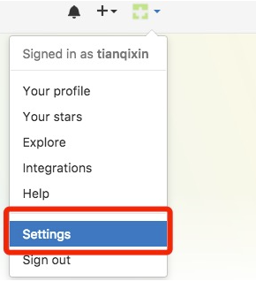
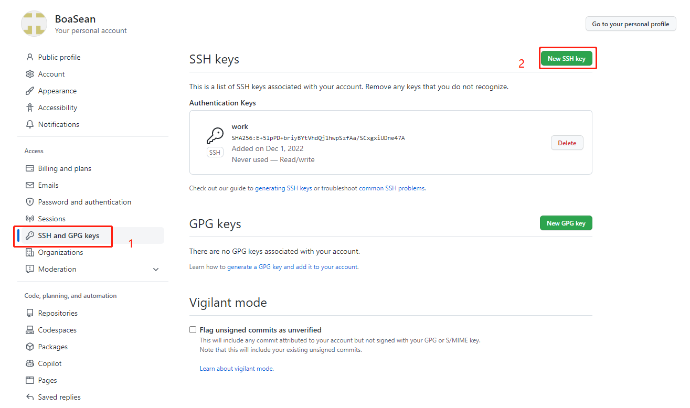
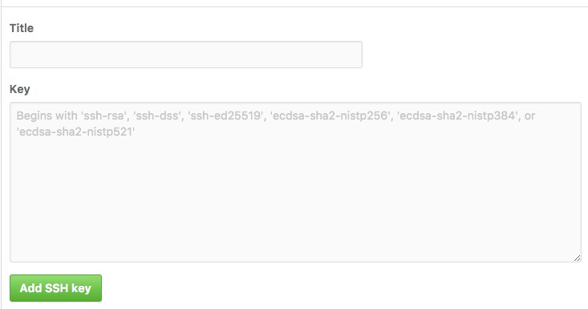
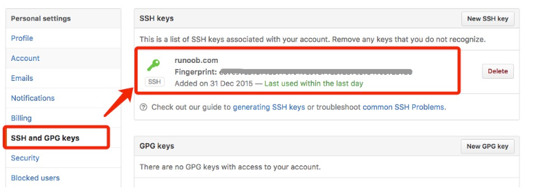

### git_install

linux

    sudo apt install git
    git --version

windows

[Git安装](https://www.runoob.com/git/git-install-setup.html)  


## c_cpp

### c_cpp_cmd
    Remove-Item -Path .\* -Recurse -Force
    cmake -G "MinGW Makefiles" ..
    mingw32-make.exe

    rm -rf ./*
    cmake ..
    make

    cmake -S . -B build -DCMAKE_EXPORT_COMPILE_COMMANDS=ON
    cmake .. -DCMAKE_EXPORT_COMPILE_COMMANDS=ON

    #linux调试
    sudo apt install glibc-source
    cd /usr/src/glibc/
    sudo tar -xvf glibc-2.35.tar.xz
    [lanch cwd] ->  /usr/src/glibc/glibc-2.35   

### gcc


    man gcc         #查看GCC支持的c版本  
    gcc -v          #查看GCC的版本
    
    -o 指定输出文件名
    -E 预处理
    -S 汇编
    -c 汇编
    -l 指定链接的库
    -L指定要链接库的文件路径
    -I 指定头文件搜索目录
    -g 编译带调试信息的可执行文件
        g++ -g test.cpp -o test
    -O[n] 优化源代码
        # -O 同时减小代码的长度和执行时间，其效果等价于-01
        # -O0 表示不做优化
        # -O1 为默认优化
        # -O2 除了完成-01的优化之外，还进行一些额外的调整工作，如指令调整等。
        # -O3 则包括循环展开和其他一些与处理特性相关的优化工作
        g++ test.cpp -O2 -o test
    -w 关闭警告信息
        g++ -w test.cpp
    -Wall 打印警告信息
        GCC的警告提示选项有很多种类型，主要可分为“-Wall”类和非“-Wall”类
        Wall类警告提示
            gcc -Wall wrong.c -o wrong
        非Wall类警告提示
            gcc -ansi wrong.c -o wrong
            gcc -pedantic wrong.c -o wrong
    -D 定义宏
        gcc -DDEBUG main.cpp14       # DEBUG内容可以被执行
    
    
    Test1
        gcc test.c -o test
        
        gcc -E test.c -o test.i                      #预处理
        gcc -S test.i -o test.s		#编译
        gcc -c test.s -o test.o		#汇编
        gcc test.o -o test		#链接
        
    test2 静态库和动态库
        动态库命名规则 lib库名.so
        静态库的命名规则 lib库名.a
        
        直接编译
            gcc  main.c src/add.c src/sub.c src/mult.c src/div.c -I include -o ./build/main
        
        静态库
            静态库的链接只链接有用的函数，普通的编译链接会链接所有函数
                nm ./build/main
                
                00000000000007dc T add
                000000000000083c T divide
                000000000000081c T multiply
                00000000000007fc T subtract
                                    nm ./build/static_main 
                00000000000007dc T add
                000000000000083c T divide
                000000000000081c T multiply
            #1.将所有要加入库的文件编译成目标文件
                    cd src/
                    gcc -c *.c
            #2.打包成静态库
                    ar -r libmmath.a *.o
            #3.生成可执行文件
                    cd ..
                    gcc main.c -l mmath -L src -I include -o ./build/static_main    #-l 指定库 -L指定库的路径  -I指定头文件路径
            #4.执行
                    ./build/static_main
            
        
        动态库
            库文件更新时将不需要修改可执行文件
            
            #1.将所有要加入库的源文件编译为与位置无关的目标文件
                    cd src/
                    gcc -c -fPIC *.c        #-fPIC: 生成位置独立的代码
            #2.打包成动态库
                    gcc -shared *.o -o libmmath.so
            #3.生成可执行文件
                    cd ..
                    gcc main.c -l mmath -L src -I include -o ./build/dyna_main      #-l 指定库 -L指定库的路径  -I指定头文件路径
            #4.执行
                #方式1——修改临时变量
                    LD_LIBRARY_PATH=src ./build/dyna_main  
                #方式2——移动到/usr/lib或者/lib
            
        
        
    
    头文件
        <>从系统目录查找
        ""从本文件夹查找
        
        //解决方法1 修改头文件引用
        #include "/src/head.h"
        
        //解决方法2 移动头文件到系统头文件下
        #include <head.h>
        
        //解决方法3 编译指定头文件路径  等同于临时加入库文件路径
        #include "head.h"
        gcc main.c -l mmath -L src -I include -o ./build/static_main -v     #-v输出编译细节
        
        
        #include "..." search starts here:
        #include <...> search starts here:
            include
            /usr/lib/gcc/aarch64-linux-gnu/11/include
            /usr/local/include
            /usr/include/aarch64-linux-gnu
            /usr/include
        End of search list.

### gdb
    
    #回车                                        # 重复上条命令
    help                                        # 查看命令帮助                               |h
    help    run

    gdb ./build/main                          # 开始调试
    file ./build/main                           # 加载符号表


    start                                       # 单步执行，运行程序，停在第一行执行语句
    next                                        # 单步调试(逐过程，函数直接执行)            |n    
    step                                        # 单步调试(逐语: 跳入自定义数内部执行)      |s
    finish                                      # 结束当前函数，返回到函数调用点
    
    
    enable breakpoints                          # 启用断点
    disable breakpoints                         # 禁用断点
    break 5                                     # 在第几行设置断点                          |b
    break *main
    info breakpoints                            # 查看当前设置的所有断点                    |i b
    delete breakpoints 5s                       # 删除第num个断点

    run                                         # 重新开始运行文件                          |r
    run argv[1] argv[2]                         # 调试时命令行传参

    continue                                    # 继续运行                                  |c


    quit                                        # 退出gdb                               |q

    list                                        # 查看原代码

    print a                                     # 打印变量a值及地址                     |p
    p/x a                                       #x按十六进制格式显示变量d 按+进制格式显示变量
                                                #u 按十六进制格式显示无符号整型
                                                #o按八进制格式显示变量
                                                #t 按二进制格式显示变量
                                                #a 按十六进制格式显示变量
                                                #c 按字符格式显示变量
                                                #f按浮点数格式显示变量
    display a                                   # 追踪查看具体变量值
    undisplay                                   # 取消所有追踪观察变量


    set                                         # 设置变量的值

    backtrace(bt)                               # 查看函数的调用的栈和层级关系
    frame(f)                                    # 切换函数的栈
    info(i)                                     # 查看函数内部局部变量的数值

    watch                                       # 被设置观察点的变量发生修改时，打印显示
    i watch                                     # 显示观察点

    x                                           # 查看内存x/20xw 显示20个单元，16进制，4字节每单元

    set follow-fork-mode child                  # Makefile项目管理: 选择跟踪父子进程 (fork())

### make

### cmake

    简单模板
        C语言
        cmake_minimum_required(VERSION 3.5.0)
        project(untitled2 C)
        set(CMAKE_C_STANDARD 11)
        add_executable(untitled2 main.c programme1.c programme1.h programme0.c programme0.h ADC5199T.c ADC5199T.h)
        
        
        C++
        cmake_minimum_required(VERSION 3.24)
        project(untitled4)
        set(CMAKE_CXX_STANDARD 17)
        add_executable(untitled4 main.cpp ModbusDevice.cpp ModbusDevice.h)
        
    
    语法
        基本语法格式: 指令(参数 1 参数 2...)
            参数使用括弧括起
            参数之间使用空格或分号分开
        指令是大小写无关的，参数和变量是大小写相关的
            set(HELLO he11o.cpp)
            add_executable(he11o main.cpp he11o.cpp）
            ADD_EXECUTABLE(he11o main.cpp ${HELLO})
        变量使用${}方式取值，但是在IF控制语句中是直接使用变量名
    常用变量
        CMAKE C COMPILER	指定C编译器
        CMAKE CXX COMPILER	指定C++编译器
            #set(CMAKE_C_COMPILER "D:/Program/mingw64/bin/gcc.exe")
            #set(CMAKE_CXX_COMPILER "D:/Program/mingw64/bin/g++.exe ")
            
        CMAKE_C_FLAGS 		gcc编译选项
        CMAKE CXX FLAGS 	              g++编译选项
            示例:set( CMAKE_CXX_FLAGS "$CMAKE_CXX_FLAGS] -std=c++11")	# 在CMAKE_CXX_FLAGS编译选项后追加-std=c++11
            
        CMAKE BUILD TYPE 	编译类型(Debug,Release)
        
        CMAKE BINARY DIR
        PROJECT BINARY DIR
        <projectname> BINARY DIR
            1.这三个变量指代的内容是一致的。
            2.如果是in source build，指的就是工程顶层目录。
            3如果是out-of-source 编译指的是工程编译发生的目录。
            4.PROJECT_BINARYDIR跟其他指令稍有区别，不过现在，你可以理解为他们是一致的
        
        CMAKE SOURCE DIR
        PROJECT_SOURCE_DIR
        <projectname>SOURCEDIR
            1.这三个变量指代的内容是一致的,不论采用何种编译方式都是工程顶层目录
            2.也就是在in source build时,他跟 CMAKE BINARYDIR 等变量一致。
            3.PROIECT SOURCE DIR 跟其他指令稍有区别现在你可以理解为他们是一致的。
        
        EXECUTABLE OUTPUT_PATH	可执行文件输出的存放路径
        LIBRARY_OUTPUT PATH	库文件输出的存放路径
        
    常用指令
        cmake_minimum_required -指定CMake的最小版本要求
            语法: cmake minimum required(VERSION versionNumber [FATAL ERRORJ)
            示例：cmake_minimum_required(VERSION 2.8.3)		 		# CMake最小版本要求为2.8.3
        
        project-定义工程名称，并可指定工程支持的语言
            语法: project(projectname[CXX][C][Java])
            示例：project(HELLOWORLD)				 		# 指定工程名为HELLOWORLD
        
        set-显式的定义变量
            语法: set(VAR[VALUE][CACHE TYPE DOCSTRING[FORCE]])
            示例：set(SRc sayhe11o.cpp he11o.cpp)					# 定义SRC变量，其值为main.cpp hello.cpp
        
        target_link_libraries- 为 target 添加需要链接的共享库 		--->相同于指定g++编译器-I参数
            语法: target link libraries(target library1<debug | optimized> library2...)
            示例：target_link_libraries(main hello)			# 将he11o动态库文件链接到可执行文件main
        
        include directories-向工程添加多个特定的头文件搜索路径 		--->相当于指定g++编译器的-l参数
            语法: include directories([AFTER|BEFORE][SYSTEM] dir1 dir2 ...)
            示例：include_directories(/usr/include/myincludefolder ./include)	# 将/usr/include/mvincludefolder 和/include 添加到头文件搜索路径
        
        link directories 向工程添加多个特定的库文件搜索路径 		--->相当于指定g++编译器的-L参数
            语法: link directories(dir1 dir2 ...)
            示例: 1ink_directories(/usr/1ib/mylibfolder ./1ib)			# 将/usr/1ib/mylibfolder 和 ./1ib 添加到库文件搜索路径
        
        add library-生成库文件
            语法: add library(libname [SHARED|STATIC|MODULE][EXCLUDE FROM ALL] source1 source2... sourceN)
            示例：add_1ibrary(hel1o SHARED $[SRCJ)					 # 通过变量 SRC 生成 ibhe11o.so 共享库
        
        add compile options -添加编译参数
            语法: add_compile_options(<option> ...)
            示例: add compile options(-wal1 -std=c++11 -O2)				# 添加编译参数 -wa11 -std=c++11
        
        add_executable-生成可执行文件
            语法: add library(exename source1 source2 ... sourceN)
            示例：add_executable(main main.cpp)					# 编译main.cpp生成可执行文件main
        
        add subdirectory-向当前工程添加存放源文件的子目录，并可以指定中间二进制和目标二进制存放的位置
            语法: add_subdirectory(source_dir [binary_dir] [EXCLUDE_FROM ALLJ)
            示例:  add_subdirectory(src)						# 添加src子目录，src中需有一个CMakeLists.txt
        
        aux source directory-发现一个目录下所有的源代码文件并将列表存储在一个变量中，这个指令临时被用来自动构建源文件列表
            语法: aux source directory(dir VARIABLE)
            示例：aux_source_directory(. SRC)					# 定义SRC变量，其值为当前目录下所有的源代码文件
                    add_executable(main ${sRC})					# 编译SRC变量所代表的源代码文件，生成main可执行文件
    使用
        内部构建——直接在根目录下构建
            cmake .			# 在当前目录下，编译本目录的CMakeLists.txt，生成Makefile和其他文件
            make			# 执行make命令，生成target
            
        外部构建——在指定目录下构建
            mkdir build		# 1.在当前目录下，创建build文件夹
            cd build		              # 2.进入到build文件夹
            cmake ..		# 3.编译上级目录的CMakeLists.txt，生成Makefile和其他文件
            make			# 4.执行make命令，生成target

### c_cpp_install

linux

    sudo apt install gcc    #安装gcc
    gcc -v                  #查看安装是否成功

    sudo apt install g++    #安装gcc
    g++ -v                  #查看安装是否成功

    sudo apt-get install gdb   #安装gdb
    gdb -v                     #查看是否安装成功 

    sudo apt install cmake    #安装cmake
    cmake --version           # 查看是否安装成功


windows

mingw安装

[MinGW下载](https://sourceforge.net/projects/mingw-w64/files/)

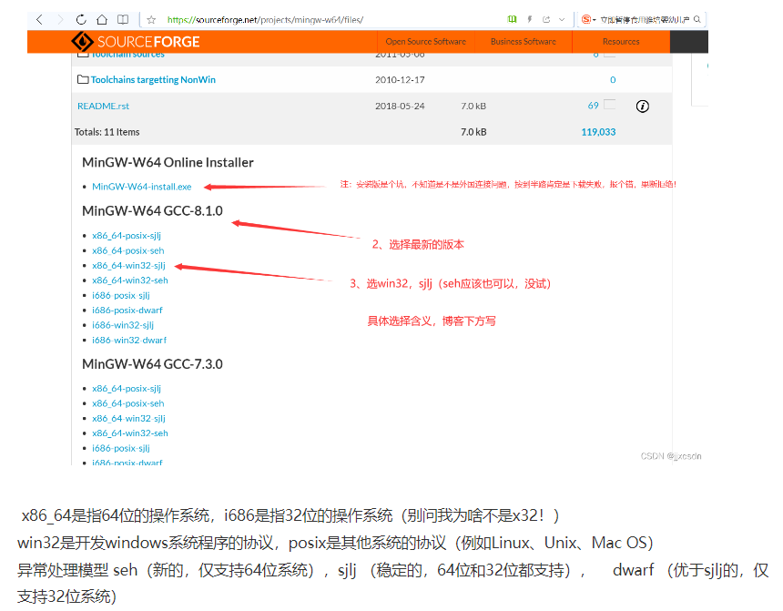

cmake安装

[cmake下载](https://cmake.org/download/)
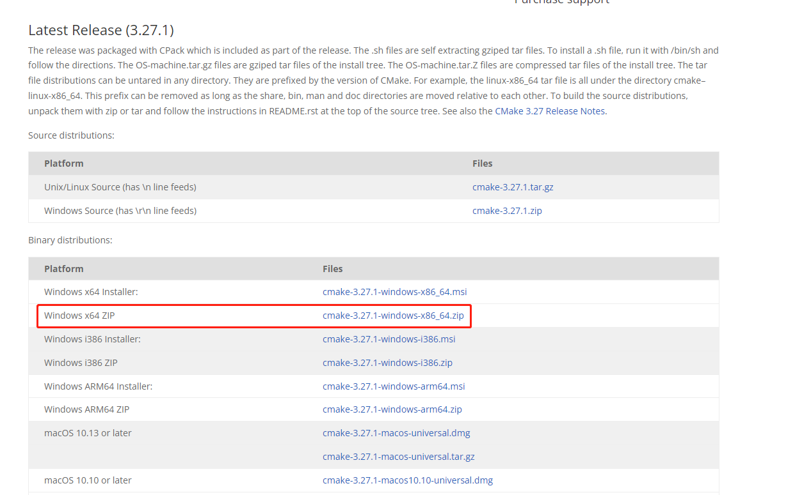

配置 mingw和cmake环境变量

    此电脑->属性->高级系统设置->环境变量

    gcc --version   
    cmake 

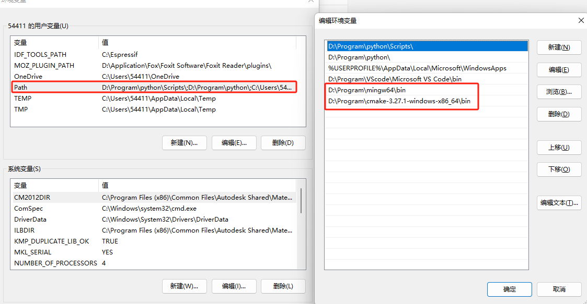


## python


### python_cmd

```sh 
    python --version  #查看python版本
    ###################运行python#########################
    #1.进入python环境
    python                  #进入python环境
    print('hello')
    #ctrl+z enter           退出python环境

    #2.运行python脚本
    python test.py

    ###################pip包管理器#########################
    pip                                         #查看pip命令
    pip -V                                      #查看pip版本
    python.exe -m pip install --upgrade pip     #更新pip

    pip list                                    #列出已经安装的包
    pip install numpy                           #安装包 可用==安装指定版本包pip install requests==2.26.0
    pip install --upgrade numpy                 #更新包 可用==更新指定版本包
    pip uninstall numpy                         #删除包

    ###################虚拟环境#########################
    #    Python中常用的虚拟环境工具有两种：
    #        virtualenv : Python的标准虚拟环境工具之一
    #        venv Python3.3自带的轻量化虚拟环境与virtualenv类似
    python -m venv venv                         #创建虚拟环境
    & ./venv/Scripts/Activate.ps1               #激活虚拟环境（windows）
    source  venv/bin/activate                   #激活虚拟环境（Linux）
    pip freeze > requirements.txt               #导出虚拟环境
    pip install -r requirements.txt             #导入虚拟环境
    deactivate                                  #退出虚拟环境

    #更改Windows的执行策略
    #1.以管理员身份运行 PowerShell 
    Get-ExecutionPolicy                         #查看当前的执行策略
    Set-ExecutionPolicy RemoteSigned            #允许本地脚本，但要求远程脚本签名
    Set-ExecutionPolicy Unrestricted            #允许所有脚本执行
```

### python_install

version

    windows
        python --version
        Python 3.10.10


linux

windows

Python安装

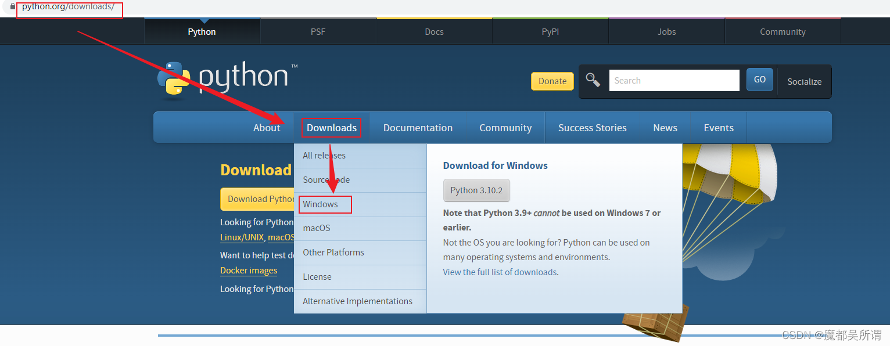
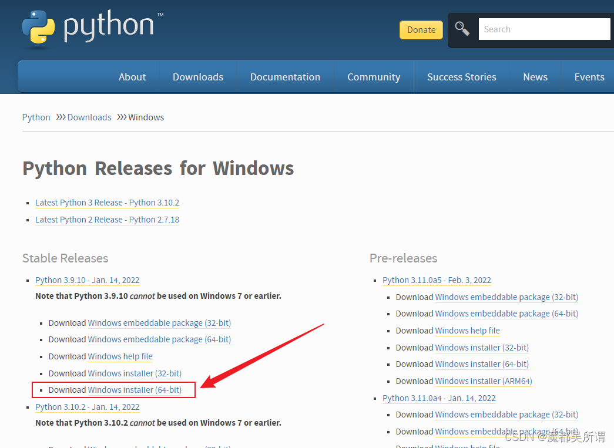
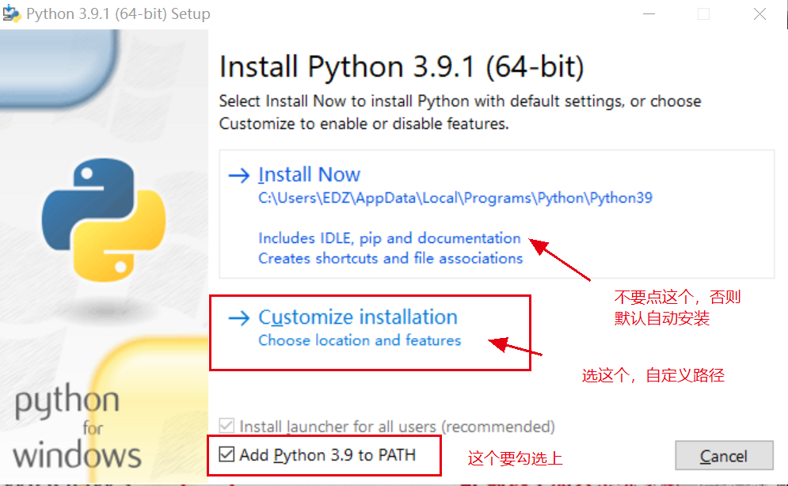
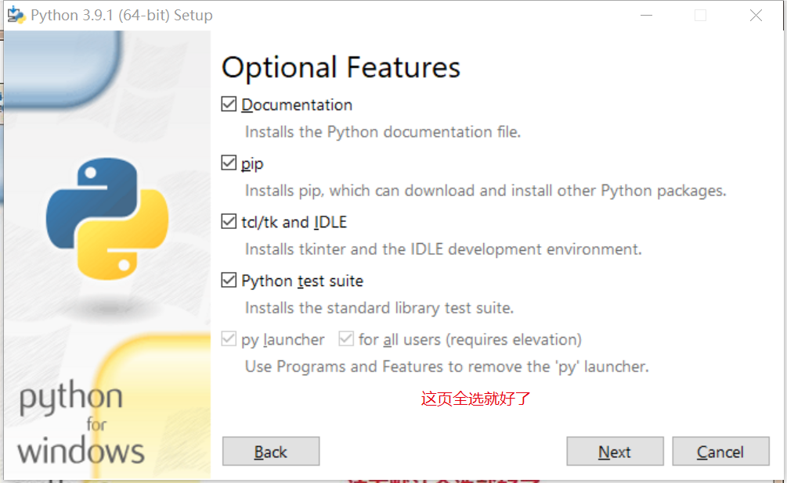

vscode调试

    {
    // 使用 IntelliSense 了解相关属性。 
    // 悬停以查看现有属性的描述。
    // 欲了解更多信息，请访问: https://go.microsoft.com/fwlink/?linkid=830387
        "version": "0.2.0",
        "configurations": [
            {
                "name": "Python: 当前文件",
                "type": "python",
                "request": "launch",
                "program": "${file}",
                "console": "integratedTerminal",
                "justMyCode": true
            }
        ]
    }


## armgcc


### armgcc_cmd


    sudo apt install gcc-arm-none-eabi
    sudo apt-get install gdb-multiarch
    sudo apt install gdb-arm-none-eabi
    sudo apt install make        
    

    arm-none-eabi-gcc --version                 dpkg -L gcc-arm-none-eabi
    gdb-multiarch --version
    arm-none-eabi-gdb --version
    make --version


    pip3 install pyserial


    Bear
        sudo apt install bear   # Ubuntu
        bear -- make

        // .vscode/c_cpp_properties.json
        {
            "configurations": [
                {
                    "name": "Linux",
                    "compileCommands": "${workspaceFolder}/compile_commands.json",
                    "intelliSenseMode": "gcc-x64",
                    "cStandard": "c11",
                    "cppStandard": "c++17"
                }
            ],
            "version": 4
        }

        vscode - cortex 

    minicom

        sudo apt install minicom  

        minicom --version

        sudo minicom -D /dev/ttyACM0 -b 115200

        ctrl A z +x    关闭

### openocd_cmd

    sudo apt install openocd 
    openocd --version


    mingw32-make        编译

    mingw32-make clean  清除编译


    https://developer.arm.com/downloads/-/gnu-rm		arm-none-eabi-g++.exe --version

    https://gnutoolchains.com/arm-eabi/openocd/			openocd.exe --version

    ------------------------------------------------------------------------------------------------------------
    D:\Program\OpenOCD-20231002-0.12.0\share\openocd\scripts\interface\jlink.cfg
    D:\Program\OpenOCD-20231002-0.12.0\share\openocd\scripts\interface\cmsis-dap.cfg
    D:\Program\OpenOCD-20231002-0.12.0\share\openocd\scripts\target\stm32f1x.cfg
    -------------------------------------------------------------------------------------------------------------

    //1 连接

    openocd -f D:\Program\OpenOCD-20231002-0.12.0\share\openocd\scripts\interface\cmsis-dap.cfg -f D:\Program\OpenOCD-20231002-0.12.0\share\openocd\scripts\target\stm32f1x.cfg      
    
    
    //2.1 下载                  控制面板->程序->程序和功能->启用或关闭 Windows 功能->启用 Telnet 客户端  
        telnet localhost 4444   Telnet 连接到端口 4444 

        transport select swd; 
        init;
        halt; 
        flash write_image erase D:/Ztest/stm103rb_make/build/stm103rb_make.bin 0x08000000;
        reset;
        shutdown


    // 2.2 调试                 2.GDB 客户端进行调试,连接到端口 3333，可以使用 GDB 客户端进行调试
        arm-none-eabi-gdb D:/Ztest/stm103rb_make/build/stm103rb_make.elf

        target remote localhost:3333

        monitor reset halt

        b applications/SysMain.c:19

        c

        q

    // 2.3                       3.Tcl 连接到端口 6666，并发送 Tcl 命令来配置和控制调试会话

        tclsh       
        % socket localhost 6666
        % puts "your tcl command here"

    ================================================================================

    SVD			System View Description用于微控制器和处理器的寄存器、外设以及系统结构的 XML 文件格式,由硬件制造商提供，目的是为开发工具和调试器提供详细的硬件描述信息。

### cubeprg_cmd


    app
        stm32cubeprg-lin_v2-10-0.zip

        /home/sean/STMicroelectronics/STM32Cube/STM32CubeProgrammer/bin/STM32_Programmer_CLI --version

    /home/sean/STMicroelectronics/STM32Cube/STM32CubeProgrammer/bin/STM32_Programmer_CLI -c port=SWD --extload /home/sean/workspace/c_cpp_workspace/Library_armgcc/artpi-1.3.0/debug/stldr/ART-Pi_W25Q64.stldr mode=NORMAL -d "/home/sean/workspace/c_cpp_workspace/Library_armgcc/artpi-1.3.0/bootloader/rtt_led.bin" 0x90000000 -hardRst -s 

    /home/sean/STMicroelectronics/STM32Cube/STM32CubeProgrammer/bin/STM32_Programmer_CLI -c port=SWD --extload /home/sean/workspace/c_cpp_workspace/Library_armgcc/artpi-1.3.0/debug/stldr/ART-Pi_W25Q64.stldr mode=NORMAL -d "/home/sean/workspace/c_cpp_workspace/Library_armgcc/artpi-1.3.0/bootloader/rtt_factory.bin" 0x90000000 -hardRst -s

    Resource_16MB

    D:\program\stm32cubeprg_v2_10_0\bin\STM32_Programmer_CLI.exe -c port=SWD --extload D:\studio\workspace\c_cpp_workspace\Library_armgcc\artpi-1.3.0\debug\stldr\ART-Pi_W25Q128JV.stldr mode=NORMAL -d "D:\studio\workspace\c_cpp_workspace\Library_armgcc\artpi-1.3.0\tools\firmware\Resource_16MB.bin" 0x70000000 -hardRst -s 
    D:\program\stm32cubeprg_v2_10_0\bin\STM32_Programmer_CLI.exe -c port=SWD --extload D:\studio\workspace\c_cpp_workspace\Library_armgcc\artpi-1.3.0\debug\stldr\ART-Pi_W25Q128JV.stldr mode=NORMAL -d "D:\studio\workspace\c_cpp_workspace\Library_armgcc\artpi-1.3.0\tools\firmware\Resource_16MB.bin" 0x70000000 --verify -hardRst


    /home/sean/STMicroelectronics/STM32Cube/STM32CubeProgrammer/bin/STM32_Programmer_CLI -c port=SWD --extload /home/sean/workspace/c_cpp_workspace/Library_armgcc/artpi-1.3.0/debug/stldr/ART-Pi_W25Q128JV.stldr mode=NORMAL -d "/home/sean/workspace/c_cpp_workspace/Library_armgcc/artpi-1.3.0/tools/firmware/Resource_16MB.bin" 0x70000000 -hardRst -s 

    boot_mdk

    D:\program\stm32cubeprg_v2_10_0\bin\STM32_Programmer_CLI.exe -c port=SWD mode=NORMAL -d "D:\studio\workspace\c_cpp_workspace\Library_armgcc\artpi-1.3.0\bootloader\boot_mdk.bin" 0x08000000 -hardRst -s 
    D:\program\stm32cubeprg_v2_10_0\bin\STM32_Programmer_CLI.exe -c port=SWD mode=NORMAL -d "D:\studio\workspace\c_cpp_workspace\Library_armgcc\artpi-1.3.0\bootloader\boot_mdk.bin" 0x08000000 --verify -hardRst

    boot_rtt

    D:\program\stm32cubeprg_v2_10_0\bin\STM32_Programmer_CLI.exe -c port=SWD mode=NORMAL -d "D:\studio\workspace\c_cpp_workspace\Library_armgcc\artpi-1.3.0\bootloader\boot_rtt.elf" -hardRst -s 
    D:\program\stm32cubeprg_v2_10_0\bin\STM32_Programmer_CLI.exe -c port=SWD mode=NORMAL -d "D:\studio\workspace\c_cpp_workspace\Library_armgcc\artpi-1.3.0\bootloader\boot_rtt.elf" --verify -hardRst

    D:\program\stm32cubeprg_v2_10_0\bin\STM32_Programmer_CLI.exe -c port=SWD mode=NORMAL -d "D:\studio\workspace\c_cpp_workspace\Library_armgcc\artpi-1.3.0\bootloader\boot_rtt.bin" 0x08000000 -hardRst -s 
    D:\program\stm32cubeprg_v2_10_0\bin\STM32_Programmer_CLI.exe -c port=SWD mode=NORMAL -d "D:\studio\workspace\c_cpp_workspace\Library_armgcc\artpi-1.3.0\bootloader\boot_rtt.bin" 0x08000000 --verify -hardRst

### cubemx_cmd

    sudo apt install openjdk-17-jre

    java --version

    sudo apt remove openjdk-17-jre
    sudo apt purge openjdk-17-jre

    unzip stm32cubemx-lin-v6-16-1.zip -d stm32cubemx
    unzip stm32cubeprg-lin_v2-10-0.zip -d stm32cubeprg

    ./program/stm32cubeprg/bin/STM32CubeProgrammer
    ./program/stm32cubemx/STM32CubeMX 

### armgcc_install

version

    OpenOCD-20231002-0.12.0/openocd
    stm32cubeprg_v2_10_0


## rtt


### rtt_cmd

    Kconfig
            Kconfig文件中的配置项会映射至rtconfig.h

        Kconfig语法及示例
        注释
        config语句					定义了一组新的配置选项
        变量类型
            bool类型
            string类型
            int类型
            hex类型
            tristate类型
        menu/endmenu语句			语句用于生成菜单
        if/endif语句					
        menuconfig语句				表示带菜单的配置项
        choice/endchoice语句		将多个类似的配置选项组合在一起供用户选择一组配置项
        comment语句				    出现在界面的第一行，用于定义一些提示信息
        source语句					用于读取另一个文件中的 Kconfig 文件

    SCons
    
        2.1 项目结构
            -- rtconfig.py    ---- 控制SCons构建的配置文件，存放了如工具链，构建参数等配置。
            -- SConscript
            -- SConstruct    ---- SCons的入口脚本，初始化了SCons构建rt-thread所需的必要环境
            -- Kconfig        ---- 顶层Kconfig文件，menuconfig的入口Kconfig文件
            -- rt-thread/
            --- src/
            ---- SConscript   ---- 各级源码的scons子脚本，控制当前级别下的源码构建行为
            ---- Kconfig      ---- 各级源码的Kconfig子脚本，存放当前级别下的配置项
            ---- **.c
        
        
        
        3 SCons 基本命令
            指定编译器及路径
            set RTT_CC=keil
            set RTT_EXEC_PATH=C:/Keilv5
        
        3.1 scons				        编译目标
        3.4 scons -jN				    多线程编译目标
        3.7 scons --verbose		        显示编译参数
        3.2 scons -c				    清除编译目标
        3.3 scons --target=XXX
            scons --target=iar
            scons --target=mdk4
            scons --target=mdk5
                生成前检查rtconfig.py中检查  EXEC_PATH 中IDE 的安装路径
        
        
            scons --target=cmake
            Scons --target=makefile
            
            scons --target=vs2012
            Scons --target=vs2005
        
        3.5 scons --dist			    搭建项目框架
        3.6 scons --dist-ide		    导出RT-Thread Studio工程项目
        3.8scons --buildlib=xxx	        打包静态库
        
        
        
        6 编译器选项 (rtconfig.py)	
            CROSS_TOOL：指定编译器
            EXEC_PATH：编译器的安装路径
                几种是正确的写法:
                EXEC_PATH = r'D:\Dir1\Dir2' 注意，字符串前带有 r，则可正常使用 “\”。
                EXEC_PATH = 'D:/Dir1/Dir2' 注意，改用 “/”，前面没有 r。
                EXEC_PATH = 'D:\\Dir1\\Dir2' 注意，这里使用 “\” 的转义性来转义 “\” 自己
        
        
                if 判断会设置 CROSS_TOOL 和 EXEC_PATH 为 Env 的默认值，配置自己的编译器时请将下列代码注释掉
                    if os.getenv('RTT_CC'):
                            CROSS_TOOL = os.getenv('RTT_CC')
                    ... ...
                    if os.getenv('RTT_EXEC_PATH'):
                            EXEC_PATH = os.getenv('RTT_EXEC_PATH')
        
            BUILD 变量控制代码优化的级别
                默认 'debug'  优化级别 0
                将这个变量修改为其他值，就会使用优化级别 2 编译
                    BUILD = ''
                    BUILD = 'release'
                    BUILD = 'hello， world'
            CFLAGS 是 C 文件的编译选项
            AFLAGS 是汇编文件的编译选项
            LFLAGS 是链接选项

    Env

        cmd /k D:\\workspace\\project_ARTPI\\SDK\\env-windows-1.5.2\\tools\\bin\\env-init.bat
        cmd /k D:\\Program\\env-windows-1.5.2\\tools\\bin\\env-init.bat                         #windows启动环境
        ~/.env/env.sh                                                                           #linux启动环境

        menuconfig
        menuconfig -s               进入Env 配置界面
        
        pkgs
        pkgs --update


    linux

        git clone -b v4.1.0 https://github.com/RT-Thread/rt-thread.git
        mv rt-thread rt_thread_4.1.0												
        git clone -b v5.1.0 https://github.com/RT-Thread/rt-thread.git
        mv rt-thread rt_thread_5.1.0

        git clone -b v1.3.0 https://github.com/RT-Thread-Studio/sdk-bsp-stm32h750-realthread-artpi.git


        CPPDEFINES = list(Env.get('CPPDEFINES', [''])) + group.get('LOCAL_CPPDEFINES', [''])


        find . -maxdepth 1 -type d -name "stm32*" ! -name "stm32h750-artpi-h750"

        find . -maxdepth 1 -type d -name "stm32*" ! -name "stm32h750-artpi-h750" -exec rm -rf {} +

        ls -d */ | grep -v "^stm32/" | xargs rm -rf


        cp -r ~/studio/programSDK/rt_thread_5.1.0/ ~/studio/workspece/

        git diff --no-index --name-only folder1/ folder2/


        scons --menuconfig

        pkgs --update


### rtt_install

version

    windows env 1.5.2  /linux  env 1.5.x
    sdk 4.1.0/sdk5.1.0

linux

    https://github.com/RT-Thread/env

    1.5.x  <=5.1.0


        wget https://raw.githubusercontent.com/RT-Thread/env/v1.5.x/install_ubuntu.sh
        chmod 777 install_ubuntu.sh
        ./install_ubuntu.sh
        rm install_ubuntu.sh

        git clone -b v4.1.0 https://github.com/RT-Thread/rt-thread.git


        cp -r stm32f103-atk-nano stm32f103-atk-nano_1

        source ~/.env/env.sh

        rm -rf ~/.env

    2.0.0 >5.1.0

windows

https://www.rt-thread.org/download.html

## idf

### idf_cmd

    
    esp-idf 
    esp-idf_v5.4.1
    Espressif

    vscode配置cmake代码提示
    {
        "configurations": [
            {
            "name": "ESP-IDF",
            "cStandard": "c11",
            "cppStandard": "c++17",
            "compileCommands": "${workspaceFolder}/build/compile_commands.json"
            }
        ],
        "version": 4
    }
    5.4.1
        运行方式1 ESP-IDF 5.4 PowerShell
        运行方式2 PowerShell执行 esp-idf\esp-idf_v5.4.1 下的install.ps1
            .\install.ps1
        
            D:\\program\\esp-idf\\esp-idf_v5.4.1\\export.ps1        #windows 启动环境
            source ~/esp/esp-idf/export.sh                          #当前中端中执行
            bash -c ~/esp/esp-idf/export.sh                         #子终端中执行

    5.5.4
            C:\\Espressif\\tools\\Microsoft.v5.5.4.PowerShell_profile.ps1   
            source /home/sean/.espressif/tools/activate_idf_v5.5.4.sh
            bash -c /home/sean/.espressif/tools/activate_idf_v5.5.4.sh

        eim-cli-windows-x64.exe

    idf.py create-project test
    
    idf.py set-target esp32c6   idf.py set-target esp32s3
    
    idf.py menuconfig
    idf.py save-defconfig                        ->sdkconfig.defaults  默认构建

    idf.py create-manifest                       ->idf_component.yml   组件管理
    idf.py update-dependencies                   ->dependencies.lock
    
    idf.py fullclean
    idf.py build
    
    idf.py -p COM7 flash
    idf.py -p COM7 monitor
    idf.py -p COM10 flash monitor

    idf.py -p COM9 app-flash monitor                //只下载app
    esptool.py erase_region 0x9000 0x6000           //只擦除nvs

    sudo chmod 777 /dev/ttyACM0
    idf.py -p /dev/ttyACM0 flash monitor
    
    CTRL + ]


    ESP32 Flash Layout (示意图)

        0x000000 - 0x000800     32KB    Bootloader (bootloader/bootloader.bin)

        0x008000 - 0x00C000     4KB     Partition Table (partition_table/partition-table.bin)

        0x009000 - 0x00F000     24KB    NVS Partition (nvs.bin, optional)
        0x00F000 - 0x010000     4KB     PHY Init Data (phy_init_data.bin)
        0x010000 - 0x810000     8MB     Factory App (handheld.bin / app.bin)
        0x810000 - 0xB10000     3MB     SPIFFS / Storage (storage.bin)

    //烧录命令
    python -m esptool --chip esp32s3 -p /dev/ttyUSB0 -b 460800 --before default_reset --after hard_reset write_flash --flash_mode dio --flash_size 16MB --flash_freq 80m 0x0 build/bootloader/bootloader.bin 0x8000 build/partition_table/partition-table.bin 0x10000 build/handheld.bin 0x810000 build/storage.bin


    //合并bin文件
    esptool.py merge_bin --output full_image.bin --flash_size 16MB \            
    0x0 build/bootloader/bootloader.bin \
    0x8000 build/partition_table/partition-table.bin \
    0x10000 build/handheld.bin \
    0x810000 build/storage.bin

    //烧录合并的bin文件
    python -m esptool --chip esp32s3 write_flash 0x0 full_image.bin


### idf_insstall

version

    idf5.4.1
    idf5.5.4/idf5.5.5

linux

    5.4.1
        sudo apt-get install git wget flex bison gperf python3 python3-pip python3-venv cmake ninja-build ccache libffi-dev libssl-dev dfu-util libusb-1.0-0

        mkdir -p ~/esp
        cd ~/esp
        git clone  -b v5.4 --recursive https://github.com/espressif/esp-idf.git

        git submodule update --init --recursive


        cd ~/esp/esp-idf
        export IDF_GITHUB_ASSETS="dl.espressif.cn/github_assets"
        ./install.sh all


    . $HOME/esp/esp-idf/export.sh

    cd ~/esp
    cp -r $IDF_PATH/examples/get-started/hello_world .
    cd ~/esp/hello_world
    idf.py set-target esp32s3
    idf.py menuconfig


    ls /dev/tty*

    sudo chmod 777 /dev/ttyACM0

    idf.py -p  /dev/ttyACM0 flash monitor

    5.5.4

        https://docs.espressif.com/projects/esp-idf/zh_CN/stable/esp32/get-started/linux-setup.html
        echo "deb [trusted=yes] https://dl.espressif.com/dl/eim/apt/ stable main" | sudo tee /etc/apt/sources.list.d/espressif.list
        sudo apt update

        https://docs.espressif.com/projects/idf-im-ui/en/latest/faq.html
        # Install the Espressif signing key
        sudo install -m 0755 -d /etc/apt/keyrings
        sudo curl -fsSL https://dl.espressif.com/dl/eim/eim.gpg -o /etc/apt/keyrings/eim.gpg
        sudo chmod 0644 /etc/apt/keyrings/eim.gpg

        # Add the Espressif APT repository (deb822 with signed-by)
        sudo curl -fsSL https://dl.espressif.com/dl/eim/eim.sources -o /etc/apt/sources.list.d/espressif.sources

        # Update package lists
        sudo apt update


        sudo apt install eim-cli

        sudo apt install python3-venv

        eim install     默认安装最新

        eim wizard      自定义安装


        source "/home/sean/.espressif/tools/activate_idf_v5.5.4.sh"

    
    sudo apt install esptool

    esptool version